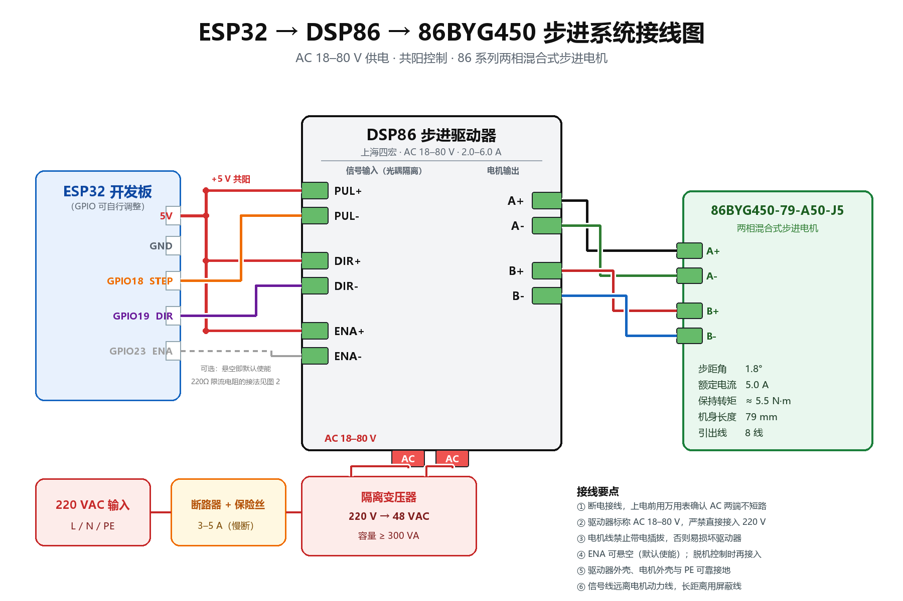
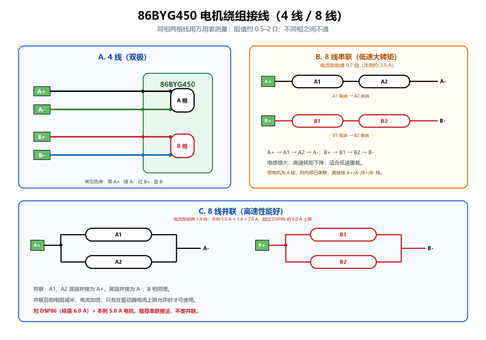
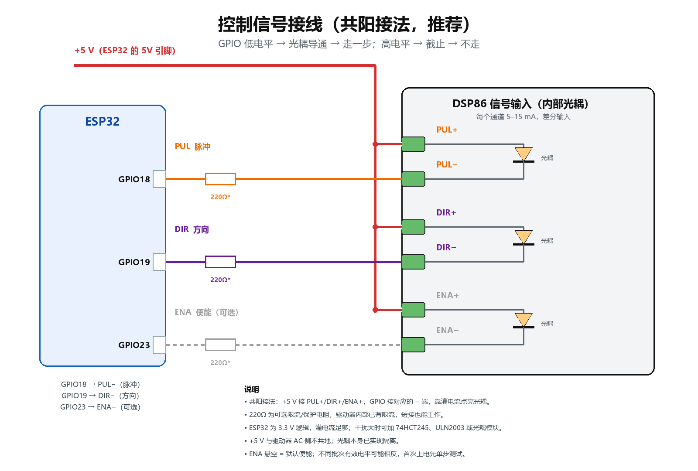

# ESP32 + DSP86 + 86BYG450 步进电机 接线与调试手册

> 适用配置：**ESP32 开发板 + 上海四宏 DSP86（AC 18–80 V，5.0 A 级）+ 86BYG450-79-A50-J5（86 系列两相混合式，1.8°，5.0 A，约 5.5 N·m，8 线）**
>
> 文档版本：v1.0　·　所有端子号、拨码位请以你手上驱动器的**侧面铭牌**为准；不同批次的端子顺序可能不同。



---

## 目录

1. [安全须知](#1-安全须知)
2. [系统组成](#2-系统组成)
3. [DSP86 驱动器参数](#3-dsp86-驱动器参数)
4. [86BYG450 电机参数](#4-86byg450-电机参数)
5. [接线步骤](#5-接线步骤)
6. [拨码设置](#6-拨码设置)
7. [ESP32 控制程序](#7-esp32-控制程序)
8. [上电与调试](#8-上电与调试)
9. [脉冲当量与速度计算](#9-脉冲当量与速度计算)
10. [故障排查](#10-故障排查)
11. [参考资料](#11-参考资料)

---

## 1. 安全须知

- 驱动器高压侧为 **AC 18–80 V**，由 220 V 隔离变压器降压后接入。**严禁把 220 V 直接接到 AC 端子**，否则立即炸机。
- 接线、改拨码、插拔电机线前**必须断电**，并等待驱动器内部电容放电（≥ 1 分钟）。
- **电机线严禁带电插拔**，否则反电动势可能击穿驱动器功率管。
- 驱动器外壳、电机外壳、变压器铁芯、电控箱体必须可靠接 **PE 保护地**。
- 首次调试建议串一只 **5 A 慢断保险丝**，并使用带漏保的插座。
- 急停开关应切断**变压器一次侧（220 V）**，而不是只关控制信号。

---

## 2. 系统组成

| 序号 | 部件 | 规格 / 型号 | 数量 | 备注 |
|---|---|---|---|---|
| 1 | 控制板 | ESP32 / ESP32-S3 开发板 | 1 | 任意带 GPIO 的型号 |
| 2 | 步进驱动器 | 上海四宏 DSP86 | 1 | AC 18–80 V，2.0–6.0 A |
| 3 | 步进电机 | 86BYG450-79-A50-J5 | 1 | 86 机座，1.8°，5.0 A，8 线 |
| 4 | 隔离变压器 | 220 V → 48 VAC，≥ 300 VA | 1 | 建议 400 VA，环形或 EI 均可 |
| 5 | 断路器 / 保险丝 | 2P 断路器 + 5 A 慢断保险丝 | 1 套 | 一次侧 |
| 6 | 急停开关 | 常闭，10 A | 1 | 切断 220 V |
| 7 | 电机电缆 | 4 芯屏蔽，1.0 mm² | 若干 | 屏蔽层单端接 PE |
| 8 | 信号电缆 | 4 芯屏蔽，0.2 mm² | 若干 | 与电机线分开走 |
| 9 | 5 V 电源 | ESP32 USB 或独立 5 V/1 A | 1 | 信号共阳用 |
| 10 | 端子 / 线鼻子 / 导轨 | — | 若干 | — |

---

## 3. DSP86 驱动器参数

### 3.1 主要电气参数

| 项目 | 参数 | 说明 |
|---|---|---|
| 输入电源 | **AC 18–80 V**（50/60 Hz） | 铭牌标注 `VAC: 18V~80V`；推荐 48 VAC |
| 输出电流 | **2.0–6.0 A**（REF 有效值），峰值最大 7.2 A | 8 档拨码可选 |
| 控制方式 | 脉冲 + 方向（STEP/DIR），使能（ENA） | 支持共阳 / 共阴 / 差分 |
| 最大脉冲频率 | 200 kHz | 出厂标称 |
| 细分 | 400–51200 步/转，共 16 档 | SW5–SW8 选择 |
| 信号输入 | 差分光耦，5–15 mA，TTL 兼容 | 3.3 V 可直接灌电流驱动 |
| 待机电流 | SW4 可选半流 / 全流 | 半流可降低发热 |
| 体积 | 151 × 97 × 48 mm | 不含端子 |
| 指示 | PWR/FAULT 指示灯 | 故障时以灯态/手册为准 |

> 你手上的是“5.0 A 级”版本，拨码表仍按 2.0–6.0 A 八档设置；**实际设定不要超过电机铭牌电流**。

### 3.2 端子定义

**信号侧（光耦隔离，低电平有效）**

| 端子 | 含义 | 接法 |
|---|---|---|
| PUL+ / PUL− | 脉冲输入 | + 接 +5 V，− 接 ESP32 GPIO（共阳） |
| DIR+ / DIR− | 方向输入 | + 接 +5 V，− 接 ESP32 GPIO |
| ENA+ / ENA− | 使能输入 | 可悬空（默认使能）；需要脱机时再接 |

**高压侧**

| 端子 | 含义 |
|---|---|
| AC / AC | 交流电源输入，AC 18–80 V |
| A+ / A− | 电机 A 相 |
| B+ / B− | 电机 B 相 |

> 实物端子排列顺序见驱动器侧面丝印；本手册图中的顺序仅作逻辑示意。

### 3.3 电流拨码表（SW1–SW3）

| REF 电流（有效值） | 峰值电流 | SW1 | SW2 | SW3 |
|---:|---:|:---:|:---:|:---:|
| 2.00 A | 2.40 A | on | on | on |
| 2.57 A | 3.08 A | off | on | on |
| 3.14 A | 3.77 A | on | off | on |
| 3.71 A | 4.45 A | off | off | on |
| 4.28 A | 5.14 A | on | on | off |
| **4.86 A** | 5.83 A | **off** | **on** | **off** |
| 5.43 A | 6.52 A | on | off | off |
| 6.00 A | 7.20 A | off | off | off |

- 电机铭牌 **5.0 A** → 选 **4.86 A**（约 97%，留一点余量，温升更低）。
- 若你的电机铭牌是 5.9 A，可选 5.43 A 档。

### 3.4 细分拨码表（SW5–SW8）

| 脉冲/转 | SW5 | SW6 | SW7 | SW8 | 步距角（1.8° 电机） |
|---:|:---:|:---:|:---:|:---:|---:|
| 400 | on | on | on | on | 0.9° |
| 800 | off | on | on | on | 0.45° |
| 1600 | on | off | on | on | 0.225° |
| **3200** | **off** | **off** | **on** | **on** | **0.1125°** |
| 6400 | on | on | off | on | 0.05625° |
| 12800 | off | on | off | on | 0.028125° |
| 25600 | on | off | off | on | 0.0140625° |
| 51200 | off | off | off | on | 0.00703125° |
| 1000 | on | on | on | off | — |
| 2000 | off | on | on | off | — |
| 4000 | on | off | on | off | — |
| 5000 | off | off | on | off | — |
| 8000 | on | on | off | off | — |
| 10000 | off | on | off | off | — |
| 20000 | on | off | off | off | — |
| 40000 | off | off | off | off | — |

**SW4：off = 半流（停机自动减流），on = 全流。** 建议先用 **off**，发热更低；若停机时保持力矩不足再改 on。

> 推荐起点：**3200 步/转**。兼顾平稳性与脉冲频率，ESP32 轻松输出。

---

## 4. 86BYG450 电机参数

### 4.1 铭牌参数（86BYG450-79-A50-J5）

| 项目 | 参数 |
|---|---|
| 机座 / 法兰 | 86 mm（NEMA 34） |
| 步距角 | 1.8°（整步） |
| 相数 | 2 相 |
| 机身长度 | 79 mm |
| 额定相电流 | **5.0 A** |
| 保持转矩 | **≈ 5.5 N·m**（同系列供应商标 5.5–5.9 N·m） |
| 引出线 | 8 线（可串联 / 并联） |
| 轴径 | 12.7 mm 或 14 mm（下单时确认） |
| 重量 | ≈ 3.5 kg |
| 绝缘等级 | B |
| 温升 | ≤ 80 K |
| 环境温度 | −20 ℃ ~ +50 ℃ |

### 4.2 绕组识别（万用表法）

1. 用万用表电阻档，找出**导通**的两两线对。
2. 同一相阻值通常在 **0.5–2 Ω**；不同相之间**不通**（∞）。
3. 8 线电机可量出 4 组线圈：A1、A2、B1、B2，每组两根线。
4. 常见色序（仅参考，务必实测）：**黑 A+、绿 A−、红 B+、蓝 B−**；中间抽头为黄/白。

### 4.3 串联 / 并联怎么选

| 接法 | 特点 | 电流设置 | 本配置是否推荐 |
|---|---|---|---|
| 8 线**串联** | 低速转矩大、高速差、发热小 | 铭牌 × 0.7 ≈ **3.5 A** | ✅ 推荐 |
| 8 线**并联** | 高速好、电流大、发热大 | 铭牌 × 1.4 ≈ **7.0 A** | ❌ 超过 DSP86 上限 |
| 4 线 | 内部已接好，直接 A+/A−/B+/B− | 按铭牌 5.0 A | 若你的电机是 4 线则用此 |

> 本例 5.0 A 电机若并联需 7.0 A，已超过 DSP86 的 6.0 A（峰值 7.2 A）能力，**不要并联满载运行**。推荐串联 + 3.5 A 档。



### 4.4 接线顺序（建议）

1. 断电，确认变压器一次侧已断开、内部电容已放电。
2. 先接 PE：驱动器外壳、电机外壳、变压器铁芯、电控箱体。
3. 接电机：按 4 线或 8 线串联接法接好 A+/A−/B+/B−，拧紧端子。
4. 接驱动器 AC：变压器次级两根线接 DSP86 的 AC、AC。
5. 设置拨码：按第 6 节设置电流、细分与半流。
6. 接信号：+5 V → PUL+/DIR+，GPIO18 → PUL−，GPIO19 → DIR−。
7. 对照 5.5 检查表复查，确认 AC 与电机相间均无短路。
8. 上电：先低速单步测试方向与平稳性，再逐步提高速度。

---

## 5. 接线步骤

### 5.1 电源侧（AC 18–80 V）

```
220 VAC (L/N/PE)
   │
   ├─ 断路器 2P ── 5 A 慢断保险丝 ── 急停开关
   │
   └─ 隔离变压器 220 V / 48 VAC（≥300 VA）
            │
            └── DSP86  AC ── AC
```

- 变压器次级**不分极性**，两根线接 DSP86 的两个 AC 端子即可。
- 变压器**必须**是隔离型；自耦调压器（如 TDGC2）不能代替隔离变压器。
- 一次侧、二次侧均建议加保险丝；二次侧 6 A 慢断。
- PE 接到驱动器散热器/外壳的接地螺钉、电控箱接地排。

### 5.2 电机侧

- 4 线：A+ / A− / B+ / B− 一一对应。
- 8 线串联：`A+ → A1 → A2 → A−`，`B+ → B1 → B2 → B−`（详见上图 B）。
- 接线前确认**相序正确**；相序错会表现为“嗡嗡响、只振动不转”。
- 电机线使用屏蔽电缆，屏蔽层**驱动器侧单端接 PE**，避免地环流。

### 5.3 控制信号侧（共阳接法，推荐）



| ESP32 | 驱动器 | 说明 |
|---|---|---|
| 5V | PUL+、DIR+ | 共阳，三根 + 端并接 +5 V |
| GPIO18 | PUL− | 脉冲；每来一个低脉冲走一步 |
| GPIO19 | DIR− | 方向；低/高对应正/反（可软件取反） |
| GPIO23（可选） | ENA− | 使能；不接 = 默认使能 |
| GND | 不接 | 光耦隔离，无需共地 |

**电平逻辑**：GPIO 输出**低电平** → 光耦导通 → 该通道有效。因此：

- 脉冲：GPIO 在“低”时导通，驱动器在光耦电流**下降沿/上升沿**计数，效果与高有效一致，只是相位相反。
- 方向：GPIO 低 = DIR 光耦导通，对应一个方向；若方向相反，交换 A+ / A−，或在代码里把 `DIR_INVERT` 取反。
- 使能：ENA 悬空时驱动器默认使能；接入后若电机反而松轴，说明该批次 ENA 有效电平相反，改接或软件取反。

**可选增强**：

- 干扰大、线长 > 1 m：加 **74HCT245**（5 V 供电）或 **ULN2003** 缓冲；也可用成品光耦隔离模块。
- 需要真正差分：使用 RS-422 差分驱动器（如 AM26LS31）输出到 PUL±/DIR±。
- 信号地与 AC 地不要短接；光耦本身已隔离。

### 5.4 接线检查表

- [ ] AC 两根线之间**不短路**（断电用万用表测）
- [ ] 电机相间**不短路**，同相导通
- [ ] A/B 相没有接反
- [ ] +5 V 没有接到 PUL−/DIR−（否则反灌）
- [ ] 驱动器外壳、电机、变压器、箱体均接 PE
- [ ] 电机线、信号线分开走线，避免平行
- [ ] 拨码方向与丝印一致（on 侧）

---

## 6. 拨码设置

本配置推荐值（DSP86，5.0 A 电机，串联接法）：

| 拨码 | 位置 | 含义 |
|---|---|---|
| SW1 | **off** | 电流档 bit0 |
| SW2 | **on** | 电流档 bit1 |
| SW3 | **off** | 电流档 bit2 → **4.86 A** |
| SW4 | **off** | 半流（停机减流） |
| SW5 | **off** | 细分 bit0 |
| SW6 | **off** | 细分 bit1 |
| SW7 | **on** | 细分 bit2 |
| SW8 | **on** | 细分 bit3 → **3200 步/转** |

> 若采用 8 线**串联**并希望按 3.5 A 运行，把电流档改为 **3.71 A**：
> SW1=off、SW2=off、SW3=on（REF 3.71 A / PK 4.45 A）。

---

## 7. ESP32 控制程序

### 7.1 引脚分配

| 功能 | GPIO | 备注 |
|---|---|---|
| STEP / PUL | 18 | 避免使用 0/2/5/12/15 等启动绑带脚 |
| DIR | 19 | 可软件取反 |
| ENA | 23 | 可选，默认不接 |

> 3.3 V GPIO 直接灌 10 mA 光耦电流没问题；若同时驱动多路或线长，建议加缓冲。

### 7.2 例程（FastAccelStepper，推荐）

安装库：Arduino IDE → 库管理器 → 搜索 **FastAccelStepper** → 安装。

```cpp
#include <FastAccelStepper.h>

#define PIN_STEP 18
#define PIN_DIR  19

// 共阳接法下，方向如与实际相反，把 true 改成 false
#define DIR_INVERT true

FastAccelStepperEngine engine = FastAccelStepperEngine();
FastAccelStepper *stepper = nullptr;

void setup() {
  Serial.begin(115200);
  delay(200);

  engine.init();
  stepper = engine.stepperConnectToPin(PIN_STEP);
  if (!stepper) {
    Serial.println("step pin init failed");
    while (true) delay(1000);
  }

  stepper->setDirectionPin(PIN_DIR, DIR_INVERT);
  stepper->setSpeedInHz(3200);      // 3200 步/秒 = 1 转/秒
  stepper->setAcceleration(6400);   // 步/秒²
  stepper->setCurrentPosition(0);

  Serial.println("DSP86 ready. cmds: m<steps> s<hz> a<hz2> z ?");
}

void loop() {
  if (!Serial.available()) return;

  String line = Serial.readStringUntil('\n');
  line.trim();
  if (line.length() == 0) return;

  char cmd = line[0];
  long val = line.substring(1).toInt();

  switch (cmd) {
    case 'm':                       // 相对移动，例：m3200
      stepper->move(val);
      Serial.printf("move %ld\n", val);
      break;
    case 's':                       // 设置速度 Hz
      stepper->setSpeedInHz(val);
      Serial.printf("speed %ld Hz\n", val);
      break;
    case 'a':                       // 设置加速度
      stepper->setAcceleration(val);
      Serial.printf("accel %ld\n", val);
      break;
    case 'z':                       // 清零
      stepper->setCurrentPosition(0);
      Serial.println("zero");
      break;
    case '?':
      Serial.printf("pos=%ld running=%d\n",
                    stepper->getCurrentPosition(), stepper->isRunning());
      break;
    default:
      Serial.println("?");
  }
}
```

**测试流程**

1. 上传程序，串口 115200。
2. 发送 `s800`（800 Hz，慢速），再发 `m3200` → 电机应转 1 圈（3200 步/转）。
3. 发 `m-3200` → 反向 1 圈。
4. 逐步提高：`s3200`、`s6400`，观察是否失步。

### 7.3 无库自检（只验证接线）

只想确认“线接对了没有”，可以用 LEDC 直接发连续脉冲（Arduino-ESP32 2.x）：

```cpp
#define PIN_STEP 18
#define PIN_DIR  19

void setup() {
  pinMode(PIN_DIR, OUTPUT);
  digitalWrite(PIN_DIR, HIGH);

  ledcSetup(0, 1000, 10);       // 通道0，1 kHz
  ledcAttachPin(PIN_STEP, 0);
  ledcWriteTone(0, 1000);       // 1000 步/秒
}

void loop() {}
```

- 电机应连续旋转；改变 `1000` 可改变转速。
- 若只振动不转 → 相序/电流问题；若完全不转 → 信号或使能问题。

> Arduino-ESP32 3.x 的 LEDC API 改为 `ledcAttach(pin, freq, res)`，按你的核心版本调整。

---

## 8. 上电与调试

### 8.1 首次上电（不带负载）

1. 断开电机轴上的联轴器/负载。
2. 拨码按第 6 节设置。
3. 先只接电源，上电：PWR 灯亮，驱动器不报故障。
4. 断电，接电机；再上电，电机应**有保持力矩**（手拧不动）。
5. 接 ESP32 信号线（断电操作），上电。
6. 发低速脉冲，观察转向与平稳性。

### 8.2 电流整定

- 从 3.71 A 档起步，运行 10 分钟，摸电机外壳温升。
- 温升 ≤ 80 K 且不失步即可；不必追求最大电流。
- 半流（SW4=off）时停机力矩会下降，属正常。

### 8.3 加减速

- 86 电机转子惯量大，**必须**设置加速度（建议 3000–10000 步/s² 起步）。
- 直接给高频脉冲会堵转/失步，表现为“响一下不走”。
- 高速上不去时：提高母线电压（48 VAC 已够）、降低细分、延长加速时间。

### 8.4 共阳/共阴选择

| 接法 | 优点 | 缺点 |
|---|---|---|
| 共阳（本手册） | 只需 3 根线 + 5 V，ESP32 灌电流 | 逻辑反相，需注意方向/使能极性 |
| 共阴 | 逻辑直观（高有效） | 需要 5 V 电平转换，3.3 V 直驱电流不足 |

---

## 9. 脉冲当量与速度计算

设：

- 细分 `N`（本配置 3200 步/转）
- 丝杠导程 `P`（mm/转）
- 减速比 `i`

则：

```
脉冲当量 = P / (N × i)        [mm/step]
速度     = f / N × 60 / i      [r/min]（f 为脉冲频率 Hz）
```

**例**：5 mm 导程丝杠，直连，3200 步/转：

- 脉冲当量 = 5 / 3200 = **0.0015625 mm/step** ≈ 1.56 µm
- 1 kHz → 1000/3200×60 = **18.75 r/min**
- 32 kHz → **600 r/min**（86 电机带载通常到不了，按转矩曲线降额）

---

## 10. 故障排查

| 现象 | 可能原因 | 处理 |
|---|---|---|
| 上电无指示 | 无 AC、保险丝断、变压器无输出 | 测 AC 端子电压；查保险丝/急停 |
| 电机松轴、可自由转动 | ENA 有效电平相反；缺相；驱动器故障 | 断开 ENA 试；查电机线；看 FAULT 灯 |
| 电机有保持力矩但不转 | 无脉冲；细分/电流为 0；PUL 接错 | 用自检程序发 1 kHz；示波器/表测 PUL− |
| 只振动、嗡嗡响 | A/B 相序错；电流过小；加速太快 | 交换 A+/A−；提高电流档；降加速度 |
| 方向相反 | DIR 逻辑相反 | 交换 A+/A−，或 `DIR_INVERT` 取反 |
| 低速正常、高速失步 | 加速太快；电压低；细分太高 | 降加速度；查 48 VAC；用 1600 细分 |
| 运行中随机丢步 | 干扰；信号线与电机线并行；地环流 | 屏蔽、单端接地、分开走线、加磁环 |
| 电机过热 | 电流档过高；半流关闭；散热差 | 降一档电流；SW4=off；改善通风 |
| 驱动器过热保护 | 长时间大电流；散热片被遮挡 | 降电流；加风扇；留散热空间 |
| 上电即炸保险 | AC 短路；接错 220 V；驱动器损坏 | 立即断电，查线，勿盲目再上电 |

---

## 11. 参考资料

- 上海四宏 DSP86 产品页：<https://www.sihengmotor.com/product/dsp86/>
- DSP86 驱动器资料与尺寸图：<https://www.shyl-technology.com/product/dsp86-stepper-motor-driver-for-nema34-motor/>
- 86BYG 系列电机参数（Mecheltron 数据表）：<https://mecheltron.eu/en/product/86byg-stepping-motor>
- 86BYG250 系列接线与参数：<http://www.zgbjdj.com/news2.asp?id=7401>
- 86BYGH450B 电机参数（5 A / 5.88 N·m）：<https://www.eaglecnctec.com/wap/products/155-stepping-motor-86bygh450b.html>
- 86BYGH450B-79-A50-J5 商品页（5.9 A / 5.5 N·m）：<https://www.phantomcncsystems.com/product-page/stepper-motor-86bygh450b-79-a50-j5-5-9a-5-5nm>

> 免责声明：以上参数整理自公开资料与驱动器铭牌照片，不同批次可能存在差异。正式设计前请以厂家最新手册和实物铭牌为准。

---

## 附录 A：一分钟接线速查

```
220VAC ── 断路器 ── 保险丝 ── 急停 ── 变压器(48VAC) ── DSP86 AC/AC
DSP86 A+ ── 电机 A+
DSP86 A- ── 电机 A-
DSP86 B+ ── 电机 B+
DSP86 B- ── 电机 B-
ESP32 5V  ── PUL+ / DIR+（共阳）
ESP32 G18 ── PUL-
ESP32 G19 ── DIR-
ESP32 G23 ── ENA-（可不接）
```

## 附录 B：推荐拨码（照片对照）

| SW1 | SW2 | SW3 | SW4 | SW5 | SW6 | SW7 | SW8 |
|:---:|:---:|:---:|:---:|:---:|:---:|:---:|:---:|
| off | on | off | off | off | off | on | on |

→ 4.86 A / 3200 步/转 / 半流待机。
