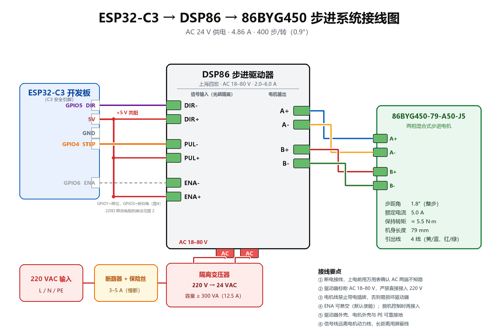
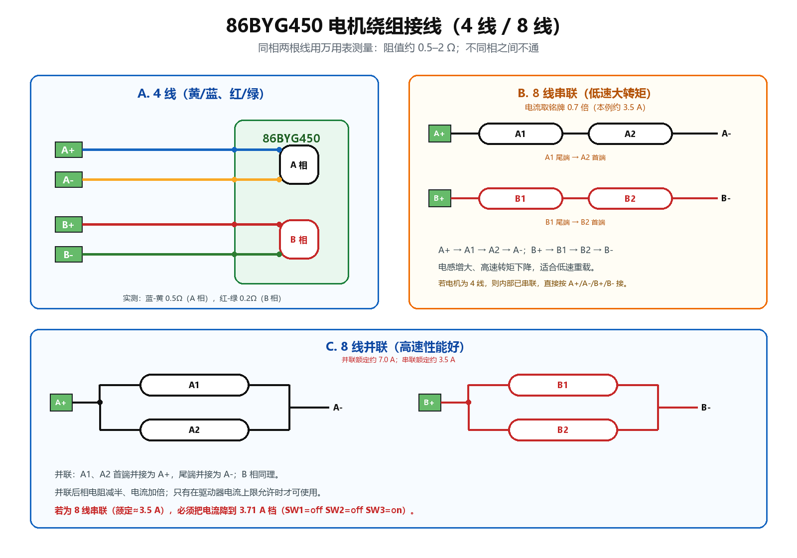
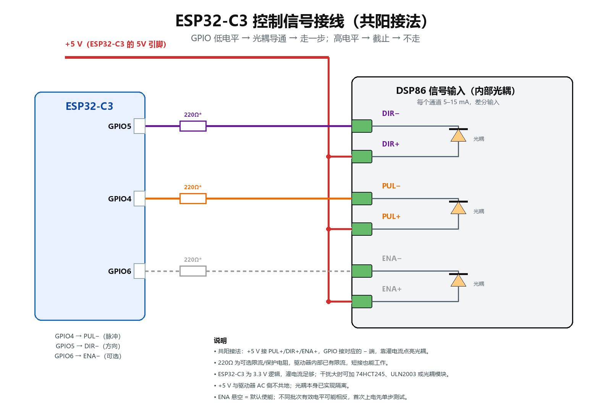
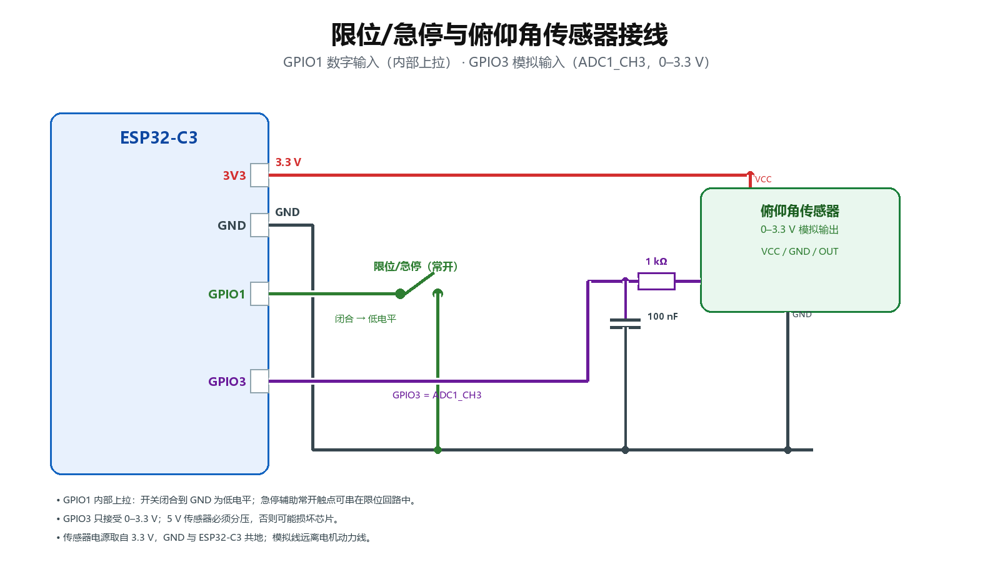
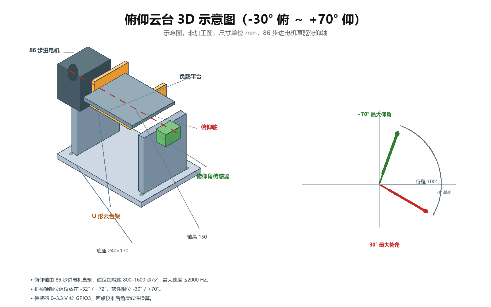

# ESP32-C3 + DSP86 + 86BYG450-79-A50-J5 接线与调试手册

> **当前配置（按你提供的拨码）**
> - 驱动器：上海四宏 DSP86，**AC 18–80 V** 输入
> - 电流：**4.86 A**（REF）/ 5.83 A（峰值）→ SW1=off，SW2=on，SW3=off
> - 细分：**400 脉冲/转** → SW5=on，SW6=on，SW7=on，SW8=on
> - 步距角：**0.9°/步**（1.8° 电机的半步模式）
> - 控制板：**ESP32-C3**，STEP=GPIO4，DIR=GPIO5，ENA=GPIO6，GPIO1=限位/急停，GPIO3=俯仰角 ADC
> - 电机：86BYG450-79-A50-J5，4 线（黄/蓝、红/绿两相），机身 79 mm



---

## 目录

1. [先确认三件事](#1-先确认三件事)
2. [安全须知](#2-安全须知)
3. [系统组成](#3-系统组成)
4. [DSP86 参数与拨码](#4-dsp86-参数与拨码)
5. [86BYG450 电机与电流校验](#5-86byg450-电机与电流校验)
6. [接线步骤](#6-接线步骤)
7. [ESP32-C3 引脚规划](#7-esp32-c3-引脚规划)
8. [ESP32-C3 控制程序](#8-esp32-c3-控制程序)
9. [上电与调试](#9-上电与调试)
10. [脉冲当量与速度](#10-脉冲当量与速度)
11. [故障排查](#11-故障排查)
12. [参考资料](#12-参考资料)

---

## 1. 先确认三件事

### ① DSP86 是交流输入，不是直流

铭牌写的是 **VAC: 18V~80V**。本系统用 **220 V / 24 VAC 隔离变压器** 降压后接入；不能接 24 V **直流**开关电源，更不能把 220 V 直接接到 AC 端子。

24 VAC 经驱动器内部整流后母线约 **32–34 VDC**，处于 DSP86 允许范围的下限附近，能正常工作，但**高速转矩会明显下降**（见 5.4 节）。

### ② 4.86 A 是否合适，取决于电机接法

| 电机接法 | 每相额定电流 | 4.86 A 占比 | 结论 |
|---|---:|---:|---|
| **4 线，5.0 A（你的电机）** | 5.0 A | **97%** | ✅ 可用（当前） |
| 4 线，5.9 A | 5.9 A | 82% | ✅ 可用 |
| 8 线并联 | ≈7.0 A（5.0×1.4） | 69% | ✅ 可用 |
| 8 线串联 | ≈3.5 A（5.0×0.7） | **139%** | ❌ 禁止，必须降到 3.71 A |

你的电机是 **4 线（黄/蓝、红/绿）**，额定 5.0 A，4.86 A 为 97%，可长期运行；若铭牌是 5.9 A，占比仅 82%，更安全。

### ③ 400 脉冲/转是“半步”，精度较粗

400 步/转 = 0.9°/步，属于半步模式。优点是低速转矩大、脉冲频率低；缺点是分辨率粗、低速共振明显。若定位精度不够或振动大，可改 **1600 步/转（0.225°）**。

---

## 2. 安全须知

- 高压侧 **AC 18–80 V**，由隔离变压器供电；**严禁 220 V 直连 AC 端子**。
- 接线、改拨码、插拔电机线前必须断电，并等待电容放电 ≥1 分钟。
- **电机线禁止带电插拔**，反电动势可能击穿功率管。
- 驱动器外壳、电机外壳、变压器铁芯、电控箱体必须接 **PE**。
- 首次调试串 **5 A 慢断保险丝**，使用带漏保的插座。
- 急停开关切断**变压器一次侧 220 V**，不是只关信号。

---

## 3. 系统组成

| 序号 | 部件 | 规格 / 型号 | 数量 | 备注 |
|---|---|---|---|---|
| 1 | 控制板 | **ESP32-C3** 开发板 | 1 | 带 USB-CDC，GPIO 丰富 |
| 2 | 驱动器 | 上海四宏 DSP86 | 1 | AC 18–80 V，2.0–6.0 A |
| 3 | 电机 | 86BYG450-79-A50-J5 | 1 | 4 线，1.8°，5.0 A |
| 4 | 隔离变压器 | 220 V → 24 VAC，≥300 VA | 1 | 建议 400 VA |
| 5 | 断路器/保险丝 | 2P + 5 A 慢断 | 1 套 | 一次侧 |
| 6 | 急停 | 常闭 10 A | 1 | 切断 220 V |
| 7 | 电机电缆 | 4 芯屏蔽 1.0 mm² | 若干 | 屏蔽单端接 PE |
| 8 | 信号电缆 | 4 芯屏蔽 0.2 mm² | 若干 | 与电机线分开 |
| 9 | 5 V 电源 | USB 或 5 V/1 A | 1 | 共阳信号用 |

---

## 4. DSP86 参数与拨码

### 4.1 主要参数

| 项目 | 参数 |
|---|---|
| 输入电源 | **AC 18–80 V**（50/60 Hz），推荐 24 VAC |
| 输出电流 | 2.0–6.0 A（REF），峰值 7.2 A |
| 控制方式 | 脉冲 + 方向 + 使能（光耦隔离） |
| 最大脉冲频率 | 200 kHz |
| 细分 | 400–51200 步/转，16 档 |
| 信号电流 | 5–15 mA，TTL 兼容，3.3 V 可驱动 |
| 体积 | 151×97×48 mm |

### 4.2 端子定义

| 端子 | 含义 | 接法 |
|---|---|---|
| PUL+ / PUL− | 脉冲 | + 接 +5 V，− 接 GPIO4 |
| DIR+ / DIR− | 方向 | + 接 +5 V，− 接 GPIO5 |
| ENA+ / ENA− | 使能 | 可悬空；接入时 − 接 GPIO6 |
| AC / AC | 交流电源 | 24 VAC |
| A+ / A− | A 相 | 电机 A 相 |
| B+ / B− | B 相 | 电机 B 相 |

### 4.3 电流拨码表（SW1–SW3）

| REF 电流 | 峰值 | SW1 | SW2 | SW3 | 说明 |
|---:|---:|:---:|:---:|:---:|---|
| 2.00 A | 2.40 A | on | on | on | |
| 2.57 A | 3.08 A | off | on | on | |
| 3.14 A | 3.77 A | on | off | on | |
| **3.71 A** | 4.45 A | **off** | **off** | **on** | 8 线串联用这档 |
| 4.28 A | 5.14 A | on | on | off | |
| **4.86 A** | 5.83 A | **off** | **on** | **off** | **当前设定** |
| 5.43 A | 6.52 A | on | off | off | |
| 6.00 A | 7.20 A | off | off | off | |

### 4.4 细分拨码表（SW5–SW8）

| 脉冲/转 | SW5 | SW6 | SW7 | SW8 | 步距角（1.8°） |
|---:|:---:|:---:|:---:|:---:|---:|
| **400** | **on** | **on** | **on** | **on** | **0.9°（当前）** |
| 800 | off | on | on | on | 0.45° |
| 1600 | on | off | on | on | 0.225° |
| 3200 | off | off | on | on | 0.1125° |
| 6400 | on | on | off | on | 0.05625° |
| 12800 | off | on | off | on | 0.028125° |
| 25600 | on | off | off | on | 0.0140625° |
| 51200 | off | off | off | on | 0.00703125° |
| 1000 | on | on | on | off | — |
| 2000 | off | on | on | off | — |
| 4000 | on | off | on | off | — |
| 5000 | off | off | on | off | — |
| 8000 | on | on | off | off | — |
| 10000 | off | on | off | off | — |
| 20000 | on | off | off | off | — |
| 40000 | off | off | off | off | — |

**SW4**：off = 半流（停机减流），on = 全流。4.86 A 电流较大，建议 **off** 降低待机发热。

### 4.5 当前拨码汇总

| SW1 | SW2 | SW3 | SW4 | SW5 | SW6 | SW7 | SW8 |
|:---:|:---:|:---:|:---:|:---:|:---:|:---:|:---:|
| off | on | off | off | on | on | on | on |

→ **4.86 A / 400 步/转 / 0.9° / 半流待机**

---

## 5. 86BYG450 电机与电流校验

### 5.1 铭牌参数

| 项目 | 参数 |
|---|---|
| 机座 | 86 mm（NEMA34） |
| 步距角 | 1.8°（整步）；400 步/转时 0.9° |
| 机身长度 | 79 mm |
| 额定相电流 | 5.0 A |
| 保持转矩 | ≈5.5 N·m |
| 引出线 | **4 线：黄/蓝一相，红/绿一相** |
| 轴径 | 12.7 / 14 mm |
| 重量 | ≈3.5 kg |

### 5.2 线色、相序与接法

4 线电机只有两相，**没有串联/并联可选**。先用万用表确认相组，再按下面示例接：

| 线色 | 示例接法 | 判断依据 |
|---|---|---|
| 蓝 | A+ | 与黄同相，实测 0.5 Ω |
| 黄 | A− | 与蓝同相 |
| 红 | B+ | 与绿同相，实测 0.2 Ω |
| 绿 | B− | 与红同相 |

- 实测：黄-蓝 0.5 Ω，红-绿 0.2 Ω；其余组合不通。
- 若实测相组与上表不同，**按实测接**，颜色只作参考。
- 上电只振动不转：交换 A+/A−（黄蓝对调）或 B+/B−（红绿对调）。
- 0.2 Ω 偏低，先短接表笔归零复测；若仍是 0.2 Ω，该相损耗更大，长时间运行注意温升。
- 若实际是 8 线（这四根之外还有 4 根），按图 3 串联/并联接；串联电流取 3.71 A。



### 5.3 4.86 A 的电流校验

4 线 5.0 A 电机：4.86 A = **97%**，可长期运行。

- 仍建议先跑 10 分钟测外壳温升；超过 **80 K** 检查散热或降档。
- 若铭牌是 **5.9 A**，4.86 A 仅 82%，更安全。
- 若是 8 线**串联**（额定≈3.5 A），4.86 A 仍超标，必须降到 3.71 A。

### 5.4 24 VAC 供电的影响（重要）

24 VAC 是 DSP86 允许范围（18–80 V）的低端，能用，但要接受两个限制：

1. **高速转矩下降**：母线仅约 34 VDC，电机反电动势和绕组电感使电流来不及建立，转速越高，实际电流越小。
   - 400 步/转时，建议工作转速 **≤200–300 rpm**（约 1300–2000 Hz）。
   - 4000 Hz（600 rpm）只在空载/轻载时可能达到，带载大概率失步。
2. **加速能力变弱**：加速时间要比 48 VAC 方案更长，建议加速度从 800–1600 步/s² 起步。

如果确实需要 400–600 rpm 带载运行：

- 换 **48 VAC / 300 VA** 变压器（DSP86 支持到 80 VAC），拨码和接线不变；
- 或降低细分（400 已是下限，不能再降）；
- 或改用闭环步进/伺服。

24 VAC 侧的选型与配线：

| 项目 | 建议 |
|---|---|
| 变压器 | 220 V / 24 VAC，**≥300 VA**（24 V 侧约 12.5 A） |
| 二次侧保险丝 | 12 A 慢断 |
| 二次侧导线 | 1.5 mm² 以上，尽量短 |
| 母线电压 | 空载约 34 VDC，加载后 30–32 VDC 属正常 |

---

## 6. 接线步骤

### 6.1 系统总图

见封面/上图：220 V → 断路器/保险丝/急停 → 24 VAC 变压器 → DSP86 → 电机；ESP32-C3 只接 5 V 与三路信号。

### 6.2 电源侧

```
220 VAC (L/N/PE)
   │
   ├─ 断路器 2P ── 5 A 慢断保险丝 ── 急停
   │
   └─ 隔离变压器 220 V / 24 VAC（≥300 VA）
            │
            └── DSP86  AC ── AC
```

- 变压器次级不分极性。
- 必须用隔离变压器，自耦调压器不能替代。
- 二次侧建议 12 A 慢断；PE 全部可靠接地。

### 6.3 电机侧

- 4 线（黄/蓝、红/绿）：蓝 A+、黄 A−、红 B+、绿 B−。
- 8 线串联：`A+ → A1 → A2 → A−`，`B+ → B1 → B2 → B−`。
- 8 线并联：A1/A2 首端并接、尾端并接。
- 相序错会“嗡嗡响、只振动不转”，交换 A+/A−。
- 屏蔽层驱动器侧单端接 PE。

### 6.4 控制信号（共阳）



| ESP32-C3 | DSP86 | 说明 |
|---|---|---|
| 5V | PUL+、DIR+ | 共阳，+ 端并接 +5 V |
| GPIO4 | PUL− | 脉冲 |
| GPIO5 | DIR− | 方向 |
| GPIO6 | ENA− | 使能；可悬空 |
| GPIO1 | — | 限位/急停输入（内部上拉，低有效） |
| GPIO3 | — | 俯仰角传感器 ADC（0–3.3 V） |
| GND | 不接 | 光耦隔离 |

**逻辑**：GPIO 低电平 → 光耦导通 → 通道有效。方向如相反，交换 A+/A− 或代码里 `DIR_INVERT` 取反。

> **ENA 特别注意**：DSP86 的 ENA 是“脱机”信号，光耦导通（GPIO 低）= 电机自由，光耦断开（GPIO 高）= 使能。代码默认 `enaActiveLow=false`，使能时输出高电平。

### 6.5 接线检查表

- [ ] AC 两端不短路
- [ ] 电机同相导通、异相不通
- [ ] A/B 相未接反
- [ ] +5 V 未接到 PUL−/DIR−
- [ ] 驱动器、电机、变压器、箱体接 PE
- [ ] 电机线与信号线分开走
- [ ] 拨码方向与丝印一致（on 侧）

---

## 7. ESP32-C3 引脚规划

### 7.1 引脚分配与避坑

ESP32-C3 有不少“坑”引脚，规划时避开：

| 类别 | GPIO | 说明 |
|---|---|---|
| ✅ 推荐普通 IO | 0、1、3、4、5、6、7、10、20、21 | 可自由使用 |
| ⚠️ 启动绑带 | 2、8、9 | 上电电平影响启动（9=BOOT） |
| ⚠️ USB | 18、19 | USB D−/D+ |
| ❌ Flash | 11–17 | 模组内部占用 |
| ⚠️ UART0 | 20、21 | 板载串口日志 |

因此：

| 功能 | GPIO | 方向 | 备注 |
|---|---|---|---|
| STEP / PUL | **4** | 输出 | 安全 IO |
| DIR | **5** | 输出 | 安全 IO |
| ENA | **6** | 输出 | 可悬空；低电平导通 |
| LIMIT / 急停 | **1** | 输入 | 内部上拉，闭合到 GND 为低 |
| PITCH 俯仰角 | **3** | 模拟输入 | ADC1_CH3，0–3.3 V |

**使用注意**

- 3.3 V 逻辑，灌电流驱动光耦没问题（每路约 10 mA）。
- 用原生 USB 串口时，Arduino IDE 勾选 **USB CDC On Boot: Enabled**。
- GPIO18/19 留给 USB；GPIO11–17 被 Flash 占用。
- GPIO2/8/9 是启动绑带脚，不要接会拉低的外部电路。
- C3 只有 ADC1（GPIO0–4）；GPIO5 属 ADC2，WiFi 开启时受限。
- GPIO3 只接 **0–3.3 V**；5 V 传感器必须分压。

---

## 8. ESP32-C3 控制程序

### 8.1 例程（FastAccelStepper）

库：Arduino IDE → 库管理器 → **FastAccelStepper**（支持 ESP32-C3）。

```cpp
#include <FastAccelStepper.h>

#define PIN_STEP   4
#define PIN_DIR    5
#define PIN_ENA    6
#define PIN_LIMIT  1
#define PIN_PITCH  3

#define DIR_INVERT     true
#define ENA_ACTIVE_LOW true
#define STEPS_PER_REV  400

const float PITCH_V_MIN = 0.50, PITCH_V_MAX = 3.00;
const float PITCH_ANGLE_MIN = -45.0, PITCH_ANGLE_MAX = 45.0;

FastAccelStepperEngine engine = FastAccelStepperEngine();
FastAccelStepper *stepper = nullptr;
float pitchAngle = 0, pitchVolt = 0;
bool limitHit = false;

void setEnabled(bool en) {
  digitalWrite(PIN_ENA, (en == ENA_ACTIVE_LOW) ? LOW : HIGH);
}

float readPitch() {
  pitchVolt = analogReadMilliVolts(PIN_PITCH) / 1000.0;
  float a = PITCH_ANGLE_MIN + (pitchVolt - PITCH_V_MIN) *
            (PITCH_ANGLE_MAX - PITCH_ANGLE_MIN) / (PITCH_V_MAX - PITCH_V_MIN);
  if (a < PITCH_ANGLE_MIN) a = PITCH_ANGLE_MIN;
  if (a > PITCH_ANGLE_MAX) a = PITCH_ANGLE_MAX;
  return pitchAngle = a;
}

void setup() {
  Serial.begin(115200);
  pinMode(PIN_LIMIT, INPUT_PULLUP);
  pinMode(PIN_ENA, OUTPUT);
  setEnabled(true);
  analogReadResolution(12);
  analogSetAttenuation(ADC_11db);

  engine.init();
  stepper = engine.stepperConnectToPin(PIN_STEP);
  stepper->setDirectionPin(PIN_DIR, DIR_INVERT);
  stepper->setSpeedInHz(800);       // 800 步/秒 = 120 rpm
  stepper->setAcceleration(1600);
  stepper->setCurrentPosition(0);
}

void loop() {
  static uint32_t t = 0;
  if (millis() - t > 100) { t = millis(); readPitch(); }

  limitHit = (digitalRead(PIN_LIMIT) == LOW);
  if (limitHit && stepper->isRunning()) {
    stepper->forceStop();
    setEnabled(false);
    Serial.println("LIMIT 触发，已停止");
  }

  if (!Serial.available()) return;
  String line = Serial.readStringUntil('
');
  line.trim();
  if (!line.length()) return;

  char cmd = line[0];
  long val = line.substring(1).toInt();

  switch (cmd) {
    case 'm':
      if (limitHit) { Serial.println("限位有效，拒绝移动"); break; }
      stepper->move(val);
      break;
    case 's': if (val > 0) stepper->setSpeedInHz(val); break;
    case 'a': if (val > 0) stepper->setAcceleration(val); break;
    case 'z': stepper->setCurrentPosition(0); break;
    case 'p': Serial.printf("pitch %.2f deg (%.3f V)
", readPitch(), pitchVolt); break;
    case '?':
      Serial.printf("pos=%ld run=%d limit=%d pitch=%.2f
",
                    stepper->getCurrentPosition(), stepper->isRunning(),
                    limitHit, pitchAngle);
      break;
    default: Serial.println("m s a z p ?");
  }
}
```

**测试**：`s800` → `m400` 应转 1 圈；`m-400` 反向；`p` 读俯仰角；再试 `s2000`、`s4000`。


### 8.2 限位/急停与俯仰角



**限位/急停（GPIO1）**

- 开关一端接 GPIO1，另一端接 GND；GPIO1 内部上拉。
- 常开开关：闭合 = 低电平 = 触发，代码中 `limitHit = (digitalRead(PIN_LIMIT) == LOW)`。
- 安全场合建议用**常闭**触点：正常为低、按下或断线变高，断线也能停机；此时把判断改为 `== HIGH`。
- 急停主回路仍必须切断 220 V，GPIO1 只做状态检测，不能代替急停。

**俯仰角（GPIO3 / ADC1_CH3）**

- 只接受 **0–3.3 V**；0–5 V 传感器用两个 10 kΩ 电阻 1:1 分压。
- 传感器 OUT 串 1 kΩ，ADC 节点对 GND 接 100 nF，抑制电机干扰。
- `analogReadMilliVolts()` 直接读电压，按传感器标定换算角度。
- 传感器电源取 3.3 V，GND 与 ESP32-C3 共地；模拟线远离电机动力线。

标定方法：用万用表测传感器在最小/最大角度时的 OUT 电压，填入 `PITCH_V_MIN/MAX`，再填角度范围 `PITCH_ANGLE_MIN/MAX`。

### 8.3 无库自检

```cpp
#define PIN_STEP 4
#define PIN_DIR  5

void setup() {
  pinMode(PIN_DIR, OUTPUT);
  digitalWrite(PIN_DIR, HIGH);

  ledcSetup(0, 400, 10);      // 400 Hz = 60 rpm
  ledcAttachPin(PIN_STEP, 0);
  ledcWriteTone(0, 400);
}

void loop() {}
```

Arduino-ESP32 3.x 改为 `ledcAttach(pin, freq, res)`。

---

### 8.4 俯仰闭环控制（-30°～+70°）



**接线**：俯仰角测试仪/传感器 OUT → GPIO3（ADC1_CH3），GND 共地，VCC 取 3.3 V；输出必须 0–3.3 V，5 V 传感器要分压。

**行程**：软件限位 **-30°（俯）～ +70°（仰）**；机械硬限位建议放在 **-32° / +72°**。

**两点校准**：

1. 手动把云台摇到 -30°，网页点“记录下限”。
2. 手动摇到 +70°，点“记录上限”。
3. 两点电压差 <0.3 V 会拒绝校准，先检查传感器。

**默认控制参数**：

| 参数 | 默认 | 说明 |
|---|---|---|
| Kp | 3 步/° | 误差 10° → 30 步/周期 |
| 死区 | 0.3° | 小于死区不动作，抑制抖动 |
| 控制周期 | 50 ms | 20 Hz 闭环 |
| 单周期最大步数 | 80 | 约 1600 步/s 上限 |

**稳定性建议**：

- 俯仰轴加配重，重心尽量过轴，减小保持力矩和超调。
- 机械硬限位 + 软件限位双保险；传感器断线立即停机。
- 加速度 800–1600 步/s²，最大速度 ≤2000 Hz（400 步/转时 2000 Hz = 300 rpm）。
- 齿轮/同步带背隙大时，先减小 Kp（2–3）、把死区加到 0.5°。
- 需要断电自锁时用蜗轮蜗杆或自锁减速机。

**保护**：

- 角度 < -32° 或 > +72° → 停止并退出闭环。
- 传感器电压 <0.05 V 或 >3.25 V → 判定故障，禁止启用。

**API**：`POST /api/pitch/target {angle}`、`/api/pitch/enable {on}`、`/api/pitch/stop`、`/api/pitch/cal {point:"min"|"max"}`。

---

## 9. 上电与调试

1. 断开负载，拨码按 4.5 节。
2. 只接电源上电：PWR 灯亮，不报故障。
3. 断电接电机，再上电：轴应有保持力矩。
4. 断电接信号线，上电。
5. 先 `s400`（60 rpm）低速跑，确认方向。
6. 逐步升到 `s2000`、`s4000`，观察是否失步/共振。
7. 运行 10 分钟测电机温升；超 80 K 降电流档。

**400 步/转的共振点**通常在 1–2 转/秒（400–800 Hz）附近；若振动明显：

- 降低该区间速度，或加加减速曲线；
- 改 1600 步/转（SW5=on、SW6=off、SW7=on、SW8=on）可显著改善。

---

## 10. 脉冲当量与速度

400 步/转、5 mm 导程丝杠、直连：

```
脉冲当量 = 5 / 400 = 12.5 µm/step
速度     = f / 400 × 60 rpm
```

| 脉冲频率 | 转速 |
|---:|---:|
| 400 Hz | 60 rpm |
| 800 Hz | 120 rpm |
| 2000 Hz | 300 rpm |
| 4000 Hz | 600 rpm |
| 200 kHz（上限） | 30000 rpm（理论） |

> 上表是理论换算。**24 VAC 带载时建议不超过 200–300 rpm**；600 rpm 只在空载/轻载可达。
>
> 400 步/转分辨率较粗；需要更高精度时改 1600 或 3200 步/转，脉冲当量分别变为 3.125 µm、1.5625 µm。

---

## 11. 故障排查

| 现象 | 可能原因 | 处理 |
|---|---|---|
| 上电无指示 | 无 AC、保险丝断、变压器无输出 | 测 AC 端子电压 |
| 电机松轴 | ENA 极性相反、缺相 | 断开 ENA 试；查电机线 |
| 有力矩不转 | 无脉冲、PUL 接错 | 自检程序发 400 Hz |
| 只振动、嗡嗡响 | 相序错、电流过小、加速太快 | 交换 A+/A−；提电流；降加速度 |
| 方向相反 | DIR 逻辑相反 | 交换 A+/A− 或改 `DIR_INVERT` |
| 低速共振 | 400 步/转半步模式 | 避开共振区或改 1600 细分 |
| 高速失步 | 加速太快、电压低 | 降加速度；查 24 VAC |
| 电机过热 | 电流档过高、串联接法 | 串联改 3.71 A；开半流 |
| 随机丢步 | 干扰、信号与电机线并行 | 屏蔽、单端接地、分开走线 |

---

## 12. 参考资料

- 上海四宏 DSP86 产品页：<https://www.sihengmotor.com/product/dsp86/>
- DSP86 资料与尺寸图：<https://www.shyl-technology.com/product/dsp86-stepper-motor-driver-for-nema34-motor/>
- 86BYG 系列参数（Mecheltron）：<https://mecheltron.eu/en/product/86byg-stepping-motor>
- 86BYGH450B 参数（5 A / 5.88 N·m）：<https://www.eaglecnctec.com/wap/products/155-stepping-motor-86bygh450b.html>
- ESP32-C3 启动模式/绑带引脚（乐鑫 datasheet）：<https://www.espressif.com/sites/default/files/documentation/esp32-c3_datasheet_cn.pdf>
- FastAccelStepper（支持 ESP32-C3）：<https://github.com/gin66/FastAccelStepper>

> 参数来自公开资料与铭牌照片，不同批次可能不同；以实物为准。

---

## 附录 A：一分钟速查

```
220VAC ── 断路器 ── 保险丝 ── 急停 ── 变压器(24VAC) ── DSP86 AC/AC
DSP86 A+ / A- / B+ / B-  →  电机对应相
ESP32-C3 5V   → PUL+ / DIR+（共阳）
ESP32-C3 G4   → PUL-
ESP32-C3 G5   → DIR-
ESP32-C3 G6   → ENA-（使能，可悬空）
ESP32-C3 G1   → 限位/急停（到 GND）
ESP32-C3 G3   → 俯仰角传感器（0–3.3 V）

拨码：off on off | off | on on on on
     4.86A      半流   400 步/转（0.9°）
```

## 附录 B：相关文件

- `esp32c3_dsp86/esp32c3_dsp86.ino`：完整示例程序
- `skills/dsp86-86byg-esp32/SKILL.md`：可复用的配置技能
- `skills/dsp86-86byg-esp32/references/params.md`：参数与拨码速查
- `skills/dsp86-86byg-esp32/scripts/dip_calc.py`：拨码计算器
- `ESP32C3_DSP86_86BYG450_接线与调试手册.docx`：Word 版


## 附录 C：可用固件经验（C3BUJINTEST）

参考工程：`C:\Users\Administrator\Documents\aily-project\C3BUJINTEST`（已实测可用，COM6 / CH340）。

**ENA 是“脱机”信号，不是普通使能**

- DSP86 光耦**导通 = 脱机（电机自由）**，光耦**断开 = 使能（保持力矩）**。
- 因此默认 `enaActiveLow = false`：使能时 GPIO6 输出**高**，脱机时输出**低**。
- 限位/急停触发后应**停机 + 脱机**，排除故障后手动恢复使能。

**WiFi（实测稳定配置）**

- `WiFi.setSleep(false)`：关闭 modem sleep，避免网页高频轮询时“间歇断连”。
- `WiFi.setTxPower(WIFI_POWER_19_5dBm)`；`WiFi.setAutoReconnect(true)`。
- 热点 `DSP86-C3` / `12345678`，信道 6，最多 4 个客户端。
- 网页配网采用“延迟切换”：先回 HTTP 响应，再 `WiFi.begin` 新凭据。

**OTA**

- `Update.begin((ESP.getFreeSketchSpace()-0x1000)&0xFFFFF000)`，先停电机并脱机。
- 响应头 `Connection: close`，成功后延时重启；失败返回 `Update.errorString()`。

**其他**

- 板载 LED GPIO8：常亮 = STA 已联网，300 ms 闪烁 = 未联网。
- 未用 GPIO0/7/10 拉低；GPIO2/9 是启动绑带脚，保持输入悬空。
- 串口 115200：`m<步> r<±1> x s<Hz> a<步/s²> n<步/转> z e d c p i ?`。
- 上电打印复位原因（欠压/崩溃/看门狗），便于排查供电。

---


