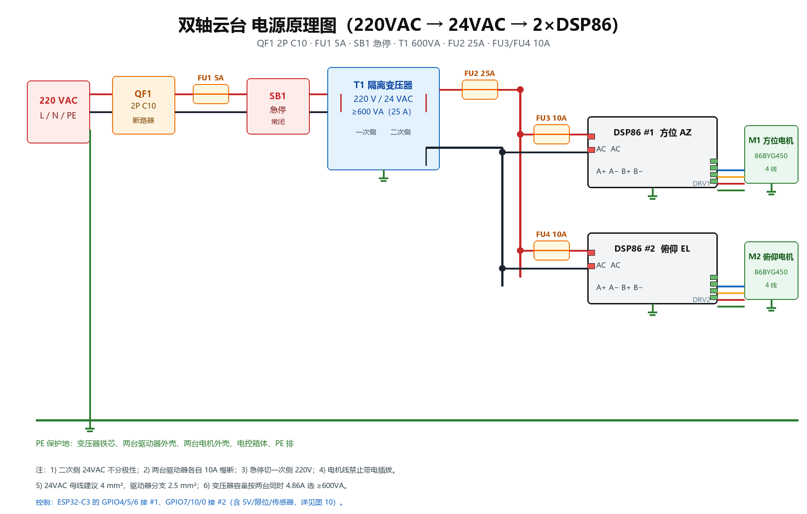
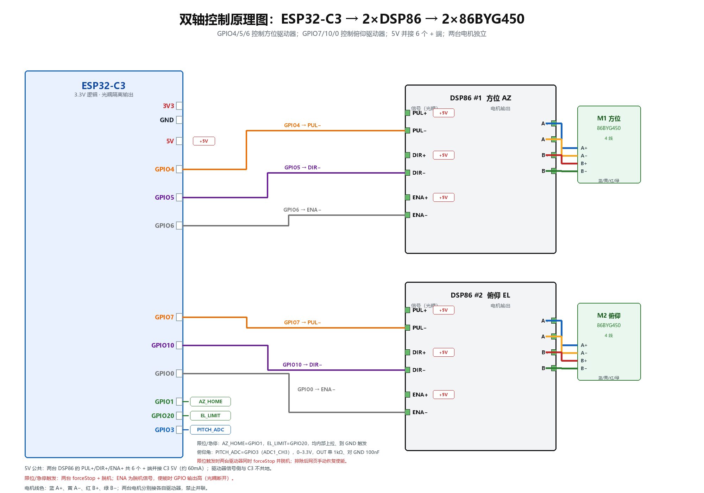
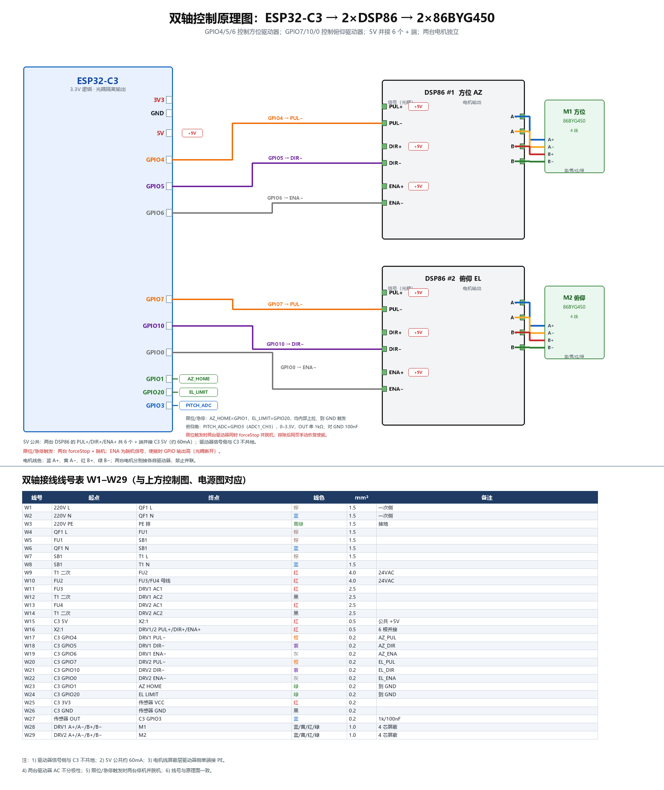
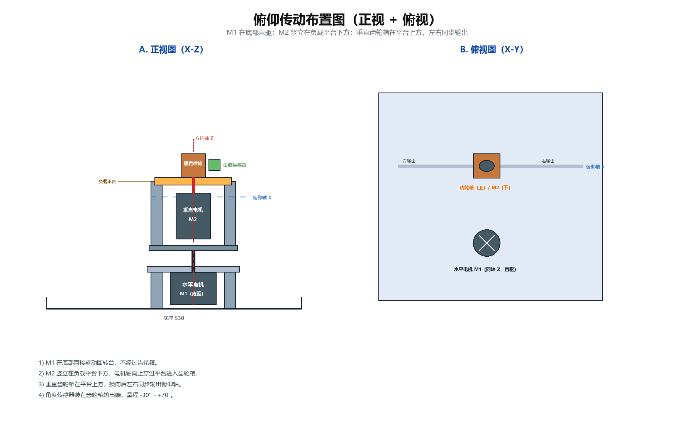
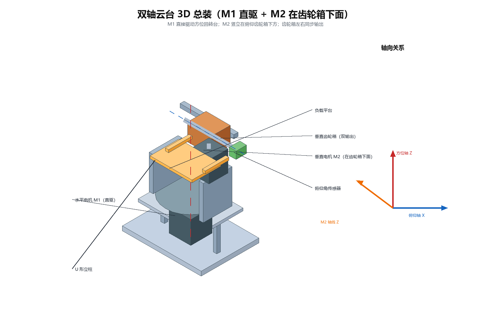

# 双轴云台完整方案（ESP32-C3 + 2×DSP86 + 2×86BYG450）

> 目标：水平方位轴 + 垂直俯仰轴，同一块 ESP32-C3 控制两台同型号 86 步进电机、两块 DSP86 驱动板。
> 俯仰范围 **-30°（俯）～ +70°（仰）**，配合俯仰角测试仪闭环。

## 图纸

| 图 | 文件 | 内容 |
|---|---|---|
| 电源原理图 | `09_power_schematic.png` | 220VAC、断路器、急停、600VA 变压器、两台 DSP86 供电 |
| 控制原理图 | `10_control_schematic.png` | C3 引脚、两台驱动器光耦信号、限位、俯仰传感器 |
| 接线图 | `11_wiring_diagram.png` | 柜内布置 + W1–W29 线号表 |







## 1. 系统架构

```
            220 VAC
               │
        断路器 / 急停 / 保险丝
               │
     隔离变压器 220 V → 24 VAC（≥600 VA）
          │                   │
      DSP86 #1            DSP86 #2
     方位 AZ             俯仰 EL
        │                   │
   86BYG450 #1         86BYG450 #2
   （水平旋转）          （垂直俯仰）
        │                   │
   ESP32-C3：STEP/DIR/ENA ×2、HOME×1、LIMIT×1、PITCH ADC×1
```

- 两台驱动器共用一个 24 VAC 变压器，**总容量按 600 VA 选**（两台同时 4.86 A）。
- 每台驱动器二次侧单独 10 A 慢断保险丝；总二次侧 25 A。
- 急停切断变压器一次侧 220 V；两台驱动器同时失电。
- 两台电机外壳、驱动器外壳、变压器、箱体全部接 PE。

## 2. 引脚规划（ESP32-C3）

| 功能 | GPIO | 说明 |
|---|---|---|
| 方位 STEP | **4** | DSP86 #1 PUL− |
| 方位 DIR | **5** | DSP86 #1 DIR− |
| 方位 ENA | **6** | DSP86 #1 ENA−（低=脱机） |
| 方位 HOME/限位 | **1** | 内部上拉，闭合到 GND |
| 俯仰 STEP | **7** | DSP86 #2 PUL− |
| 俯仰 DIR | **10** | DSP86 #2 DIR− |
| 俯仰 ENA | **0** | DSP86 #2 ENA− |
| 俯仰限位 | **20** | 原 UART RX，改为输入；串口只保留 TX21 |
| 俯仰角传感器 | **3** | ADC1_CH3，0–3.3 V |
| 状态 LED | **8** | 常亮=WiFi 已连，闪=未连 |
| 串口 TX | **21** | 115200，仅输出日志 |
| 启动绑带 | **2 / 9** | 保持输入悬空，不驱动 |

> 串口初始化用 `Serial.begin(115200, SERIAL_8N1, -1, 21)`，释放 GPIO20 做俯仰限位。
> 上传仍走 COM6/CH340 的 ROM 下载，不受影响。

**两台 FastAccelStepper**：C3 的 RMT 支持 2 路步进，官方示例即 `step:6` 与 `step:7` 两路，本项目用 4 与 7。

## 3. 电源与 BOM

| 序号 | 部件 | 规格 | 数量 |
|---|---|---|---|
| 1 | 隔离变压器 | 220 V → 24 VAC，**≥600 VA**（25 A） | 1 |
| 2 | 步进驱动器 | DSP86（上海四宏） | 2 |
| 3 | 步进电机 | 86BYG450-79-A50-J5 | 2 |
| 4 | 主保险丝 | 一次侧 5 A 慢断 | 1 |
| 5 | 二次侧总保险 | 25 A 慢断 | 1 |
| 6 | 分路保险 | 10 A 慢断 | 2 |
| 7 | 急停 | 常闭 10 A，切 220 V | 1 |
| 8 | 电机电缆 | 4 芯屏蔽 1.0 mm² | 2 |
| 9 | 信号电缆 | 屏蔽 0.2 mm² | 若干 |
| 10 | 方位传动 | 回转支承/大齿圈 + 小齿轮，或蜗轮蜗杆 | 1 套 |
| 11 | 俯仰轴承 | 一对带座轴承/耳轴 | 1 套 |

## 4. 接线要点

### 4.1 两台驱动器的共阳信号

- ESP32-C3 的 **5V** 并接两台 DSP86 的 `PUL+ / DIR+ / ENA+`。
- 方位：GPIO4→PUL−，GPIO5→DIR−，GPIO6→ENA−。
- 俯仰：GPIO7→PUL−，GPIO10→DIR−，GPIO0→ENA−。
- 两台驱动器信号地不接 ESP32 地（光耦隔离）。
- 5V 负载：6 路光耦约 60 mA，C3 板 5V 可承受；若同时带传感器，建议独立 5V/1A。

### 4.2 ENA 极性（关键）

DSP86 的 ENA 是**脱机**信号：

- 光耦导通（GPIO 低）= 电机自由；
- 光耦断开（GPIO 高）= 使能保持力矩。

默认 `enaActiveLow = false`，使能输出高。限位/急停触发时**两台都停机 + 脱机**。

### 4.3 限位与传感器

- 方位 HOME：GPIO1 内部上拉，常开开关到 GND；回零后设为 0°。
- 俯仰限位：GPIO20 内部上拉，建议 -32° 与 +72° 各一只，串联后到 GND。
- 俯仰角传感器：0–3.3 V → GPIO3，OUT 串 1 kΩ，ADC 节点对 GND 接 100 nF。

### 4.4 电机线

两台电机均为 4 线：**蓝 A+、黄 A−、红 B+、绿 B−**（实测相组，蓝-黄 0.5 Ω、红-绿 0.2 Ω）。
两台分别接各自 DSP86 的 A+/A−/B+/B−，**不要并联电机**。

## 5. 控制策略

| 轴 | 控制方式 | 行程 | 关键参数 |
|---|---|---|---|
| 方位 AZ | 开环 + HOME 回零 | 软件 ±180°（可配置） | 800–2000 Hz，加速 1600 步/s² |
| 俯仰 EL | 角度闭环（传感器） | -30°～+70° | Kp=3 步/°，死区 0.3°，50 ms |

- 回零：方位慢速找 HOME → 停止 → 位置清零 → 设软件零点。
- 俯仰：两点校准 -30°/+70°，闭环定位；超程/传感器故障立即停机。
- 联动：先俯仰到位，再方位旋转（避免负载惯性耦合）；或两轴同时但降速 50%。
- 任一路限位触发：两台都 `forceStop()` + 脱机，网页提示，手动复位。

## 6. 固件改造

- 两个 `FastAccelStepper*`：`azStepper`（STEP4）、`elStepper`（STEP7）。
- `Axis` 结构体：step/dir/ena/limit、位置、速度、加速度、使能。
- 状态 JSON：`axes:[{az...},{el...}]` + `pitch` 闭环对象。
- API：
  - `POST /api/axis/1/jog {steps}`、`/api/axis/2/target {angle}`
  - `POST /api/home {axis:1}`
  - `POST /api/stop`（两台）
- 网页：双轴卡片 + 俯仰校准页，保留 WiFi/OTA。

## 7. 机械布置（M1 直驱 + M2 在平台下方 + 齿轮箱在平台上方）





- **M1 在底部直接驱动方位回转台**，不经过齿轮箱。
- **M2 竖立在负载平台下方**，电机轴向上穿过平台进入齿轮箱。
- **垂直齿轮箱在负载平台上方**，换向后左右同步输出俯仰轴。
- 角度传感器装在齿轮箱输出端，量程 -30°～+70°。
- 外形可沿用 U 形叉架/立柱/蜗轮箱体；传动关系按图。

## 8. 调试顺序

1. 单台 DSP86 + 单电机：确认拨码、相组、ENA 极性、方向。
2. 接入第二台：确认两路 STEP 独立、互不丢步。
3. 方位回零、软件限位；俯仰两点校准。
4. 双轴联动，观察 24 VAC 母线压降；必要时加大变压器。
5. 连续 30 分钟老化，测两台电机与变压器温升。

## 9. 风险

- 两台同时 4.86 A，24 VAC 母线压降明显；600 VA 是下限，重载建议 800 VA。
- C3 只有 2 路 RMT，正好两轴；不要再加第三轴。
- GPIO20 改输入后串口无 RX，调试命令需走网页；上传不受影响。
- 方位若无编码器，回零后开环定位，齿轮背隙会带来重复误差。
