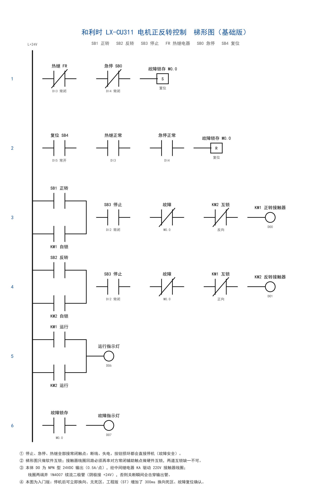
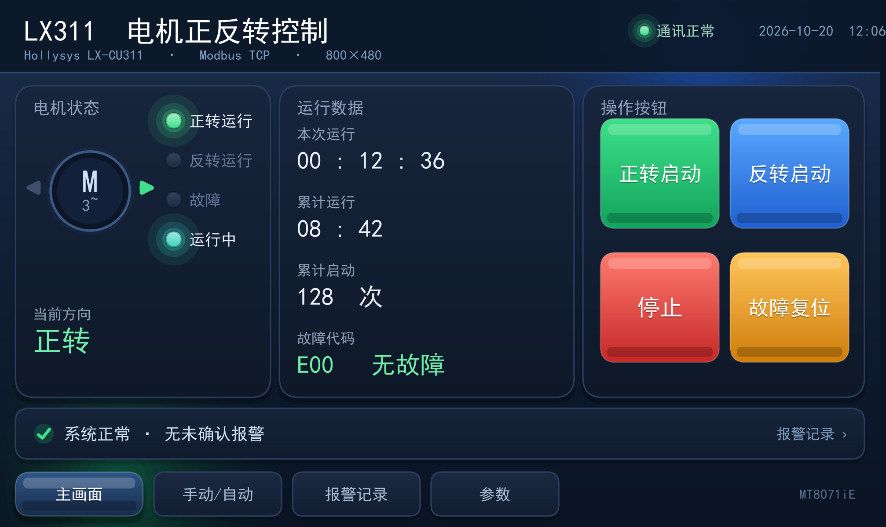
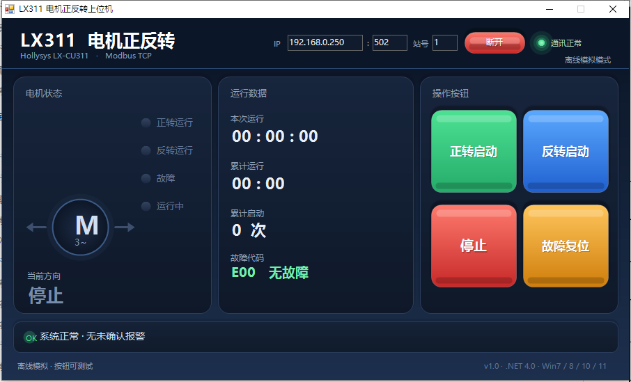

# 和利时 LX-CU311 电机正反转控制程序

> **适用对象**：和利时 LX-CU311 紧凑型 PLC（本文简称 LX311），本体 16DI/16DO，用接触器换相控制一台三相异步电动机正转 / 反转。
> **编程软件**：iAT（Intelligent AutoThink）V5.0，IEC 61131-3。
> **程序语言**：梯形图（LD，基础版）+ 结构化文本（ST，工程版，可直接粘贴）。
>
> ⚠️ 前提确认：本程序按 **LX-CU311（%I/%Q、iAT 编程）** 编写。如果你手上是 FX 兼容的 LX3V/LX3G（PowerPro 编程、X/Y 软元件），指令格式不同，需要另出一版。

---

## 1. 控制要求

| 操作 | 结果 |
|---|---|
| 按正转启动 SB1 | KM1 吸合，电机正转，运行灯亮；松开按钮后自保持 |
| 按反转启动 SB2 | KM2 吸合，电机反转 |
| 运行中直接按反向按钮 | 先断开当前接触器，**等 300 ms** 再吸合反向接触器（先断后合，防止相间短路、减小电弧） |
| 按停止 SB3 | 立即停机，不自启 |
| 热继 FR 动作 | 立即停机 + 故障灯亮 + **故障锁存**，FR 复位后仍需按复位 SB4 才能再启动 |
| 急停 SB0 | 硬线直接切断接触器线圈 + PLC 锁存故障（双通道） |
| 任何时刻 | KM1、KM2 绝不同时吸合（软件互锁 + 硬件互锁） |

---

## 2. 硬件配置

| 项目 | 规格 / 选型 | 备注 |
|---|---|---|
| PLC | 和利时 LX-CU311 | 系统电源 24VDC（19.2–28.8V），本体 3.5W |
| 本体 DI | 16 路（12 高速 + 4 常规），24VDC，PNP/NPN 每 8 路一组可配 | 本方案用 NPN 模式（低电平有效） |
| 本体 DO | 16 路，**NPN 型**（漏型），0.5A/点、4A/16 点 | **无内置续流二极管**，感性负载必须外并 |
| 主回路 | 三相 380V，断路器 QF、接触器 KM1/KM2、热继 FR | KM2 侧对调任意两相实现反转 |
| 中间继电器 | KA1/KA2，24VDC 线圈（≤0.6W） | PLC 输出只驱动 KA，不直接带 220V 接触器 |
| 控制电源 | 24VDC 开关电源 ≥ 30W | 与 PLC 系统电源分开更稳妥 |
| 急停 | 带自锁的蘑菇头，**常闭** | 硬线串入 KM 线圈回路 |

---

## 3. I/O 分配表

| 端子 | 变量名（ST） | 现场元件 | 触点类型 | 说明 |
|---|---|---|---|---|
| DI0 | `xFwdPB` | SB1 正转启动 | 常开 | 点动按钮，程序取上升沿 |
| DI1 | `xRevPB` | SB2 反转启动 | 常开 | 同上 |
| DI2 | `xStopPB` | SB3 停止 | **常闭** | 未按 = TRUE；断线也停机 |
| DI3 | `xFR` | FR 热继电器 | **常闭** | 正常 = TRUE |
| DI4 | `xEStop` | SB0 急停 | **常闭** | 正常 = TRUE |
| DI5 | `xResetPB` | SB4 故障复位 | 常开 | 故障消除后按一下 |
| DO0 | `xKM1` | KM1 正转接触器 | — | 经 KA1 驱动 |
| DO1 | `xKM2` | KM2 反转接触器 | — | 经 KA2 驱动 |
| DO6 | `xLampRun` | HL1 运行指示（绿） | — | 24V 指示灯，≤50mA |
| DO7 | `xLampFault` | HL2 故障指示（红） | — | 同上 |
| M0.0 | `xFault` | 内部故障标志 | — | 掉电不保持，重新上电需重新启动 |

> **为什么停止/急停/热继都用常闭？** 断线、端子松动、按钮被砸坏、24V 失电，表现都等同于"按了停止"，属于故障安全（fail-safe）接法。若接常开，断线时 PLC 会认为"没按停止"，机器照转。

---

## 4. 接线

### 4.1 主回路（三相 380V）

```
 L1 L2 L3
  │  │  │
 ┌┴──┴──┴┐
 │   QF   │  三相断路器（带短路/过载保护）
 └┬──┬──┬┘
  │  │  │
  ├──┼──┼──────[KM1 主触点]──────┐
  │  │  │                        │
  ├──┼──┼──┐                     │
  │  │  │  └──[KM2 主触点]──(L1/L3 对调)──┤
  │  │  │                        │
  └──┴──┴────────────────────────┤
                                  │
                             ┌────┴────┐
                             │   FR    │  热继电器（整定 = 电机额定电流）
                             └────┬────┘
                                  │
                                 (M) 三相异步电动机
```

- KM2 的两根出线交换 L1、L3（或 L2、L3），即可实现反转；**不要**用倒顺开关代替。
- 电机外壳、PLC 的 PE、开关电源 PE 全部可靠接地。

### 4.2 控制回路（24V 侧 + 220V 接触器线圈侧）

```
 24V+ ──┬──────────────┬──────────────┬───────── F24V+ (DO 端子 A8)
        │              │              │
      KA1线圈        KA2线圈         HL1/HL2
        │              │              │
      DO0            DO1          DO6 / DO7
        │              │              │
 COM ───┴──────────────┴──────────────┴───────── COM (DO 端子 B8) → 0V

 每个线圈两端反并 1N4007：阴极接 +24V，阳极接 DO 端子（续流，必须加）
```

```
 220V L ──[QF2]──[SB0 急停 NC]──[FR 95-96 NC]──┬──[KA1 NO]──[KM2 NC]──(KM1 线圈)── N
                                               │
                                               └──[KA2 NO]──[KM1 NC]──(KM2 线圈)── N
```

要点：

1. **急停、热继串在接触器线圈回路里**（硬线），不依赖 PLC —— PLC 死机也能停机。
2. **KM1 线圈串 KM2 常闭辅助触点、KM2 线圈串 KM1 常闭辅助触点** —— 硬件互锁，与程序里的软件互锁构成双重保护。
3. PLC 的 DO 只驱动 24V 中间继电器 KA（约 25mA），220V 接触器线圈由 KA 触点接通，避免 0.5A 输出能力和隔离问题。
4. 24V 指示灯直接接 DO 时注意极性：NPN 输出是**低电平有效**，灯的一端接 +24V，另一端接 DO。

### 4.3 DI 接线（NPN 模式）

```
 +24V ── SS0 / SS1 （公共端）
 SB1 ──┬── DI0       按钮另一端接 0V，按下 → DI0 被拉到 0V → ON
 SB3 ──┴── DI2（常闭）未按 → DI2 被拉到 0V → ON；按下/断线 → OFF
```

- 若现场习惯 PNP：SS0/SS1 接 0V，按钮接 +24V，则程序里所有输入逻辑取反（本程序不适用，需改）。
- DI 组模式在 iAT 的"本体 IO"里配置，**每 8 路一组**，DI0–DI7 用 SS0、DI10–DI17 用 SS1。

### 4.4 图纸

| 图 | 文件 | 内容 |
|---|---|---|
| 图 1 | [`图1_主回路接线图.png`](图1_主回路接线图.png) | 三相主回路：QF1 → FR → KM1/KM2 并联换相 → 电机 U1/V1/W1；含电机接线盒 6 端子（Y/Δ）与设备表 |
| 图 2 | [`图2_控制原理图.png`](图2_控制原理图.png) | 220V 接触器线圈回路（含双重互锁）+ 24V PLC 全部 I/O 接线、续流二极管详图 |
| 图 3 | [`图3_接线端子图.png`](图3_接线端子图.png) | X1 主回路（4 位）/ X2 控制信号（8 位）/ X3 24V 输出（6 位）端子排：柜内侧、现场侧、线号、电缆 |

图 1 关键点：

- KM2 出线把 **L1 与 L3 对调**（U1←L3，W1←L1），这是反转的唯一来源，不要靠倒顺开关。
- 电机铭牌 380V 时接 **Y**（W2/U2/V2 短接）；若电机是 220V/Δ 或变频器供电，按 Δ 接（U1-W2、V1-U2、W1-V2）。

图 2 关键点：

- 220V 回路的 L 侧依次是 QF2 → SB0 急停 → FR(95-96)，再分成 KM1 / KM2 两条带互锁的支路，**急停与热继不经过 PLC**。
- 24V 侧：SS0/SS1 接 +24V（NPN 模式），6 个按钮/触点接 DI0–DI5，另一端回 0V；DO0/DO1 驱动 KA1/KA2，DO6/DO7 驱动指示灯，负载另一端接 F24V+。
- KA1/KA2 线圈和指示灯两端都要并 1N4007（阴极接 +24V），图中右下角给出了接法详图。

### 4.5 外部接线表（现场照此接线）

| PLC 端子 | 接到 | 线径 | 说明 |
|---|---|---|---|
| DI0 | SB1 一端（另一端接 0V） | 0.75 mm² | 正转启动，NO |
| DI1 | SB2 一端（另一端接 0V） | 0.75 mm² | 反转启动，NO |
| DI2 | SB3 一端（另一端接 0V） | 0.75 mm² | 停止，**NC** |
| DI3 | FR 97-98（另一端接 0V） | 0.75 mm² | 热继第二组 NC |
| DI4 | SB0 第二组 NC（另一端接 0V） | 0.75 mm² | 急停，与硬线回路分开 |
| DI5 | SB4 一端（另一端接 0V） | 0.75 mm² | 故障复位，NO |
| SS0 / SS1 | +24V | 0.75 mm² | NPN 输入公共端 |
| DO0 | KA1 线圈 −（线圈 + 接 F24V+） | 0.75 mm² | 正转 |
| DO1 | KA2 线圈 − | 0.75 mm² | 反转 |
| DO6 | HL1 −（HL1 + 接 F24V+） | 0.5 mm² | 运行指示 |
| DO7 | HL2 − | 0.5 mm² | 故障指示 |
| F24V+ (A8) | 24V+ ，并供 KA/HL | 1.0 mm² | 现场电源正 |
| COM (B8) | 0V | 1.0 mm² | 现场电源负，与 0V 等电位 |

| 220V 回路 | 连接顺序 |
|---|---|
| KM1 支路 | L → QF2 → SB0(11-12) → FR(95-96) → KA1(11-14) → KM2(21-22 NC) → KM1 线圈 A1，A2 → N |
| KM2 支路 | 同上公共段 → KA2(11-14) → KM1(21-22 NC) → KM2 线圈 A1，A2 → N |

---

## 5. 程序

### 5.1 梯形图（基础版，适合理解与课堂/验收演示）



| 行 | 作用 | 逻辑 |
|---|---|---|
| 1 | 故障置位 | 热继断开 **或** 急停断开 → `(S) M0.0` |
| 2 | 故障复位 | 复位按钮 + 热继正常 + 急停正常 → `(R) M0.0` |
| 3 | 正转 | SB1 / KM1 自锁 → 停止、无故障、KM2 未吸合 → KM1 |
| 4 | 反转 | SB2 / KM2 自锁 → 停止、无故障、KM1 未吸合 → KM2 |
| 5 | 运行灯 | KM1 或 KM2 吸合 → DO6 |
| 6 | 故障灯 | M0.0 → DO7 |

> 两点说明：
> ① 图中 SB3、FR、SB0 在程序里画的是**常开触点**——因为现场接的是常闭按钮，未动作时输入为 TRUE（见 4.3）。
> ② 基础版**没有换向死区**：运行中直接按反向，只能靠接触器自己灭弧，实际设备上容易拉弧。正式设备请用下面的工程版。

### 5.2 ST 工程版（推荐，可直接粘贴进 iAT）

完整代码见 [`PRG_MotorFwdRev.st`](PRG_MotorFwdRev.st)，核心逻辑分 6 段：

| 段 | 内容 | 关键点 |
|---|---|---|
| 1 | 故障锁存 | 热继/急停断开即置位；恢复后必须按复位才清除 |
| 2 | 按钮上升沿 | 只用 BOOL 变量做边沿，不依赖 R_TRIG 库 |
| 3 | 方向请求 | 后按优先；停止或故障立即清除请求 |
| 4 | 换向死区 | `tonDead(IN := (iStep = 0), PT := T#300MS)` |
| 5 | 方向状态机 | 0 停止 / 1 正转 / 2 反转；换向必须先回 0 |
| 6 | 输出映射 | `xKM1 := (iStep = 1); xKM2 := (iStep = 2);` 天然互斥 |

三个设计要点：

1. **输出由状态机唯一派生**——`xKM1`、`xKM2` 分别对应 `iStep=1`、`iStep=2`，结构上不可能同时为 1，比"两个自锁回路各加一个常闭互锁"更可靠。
2. **死区计时从"输出全断"开始**——进入停止步后 TON 从 0 计时，300 ms 后才允许进入另一个方向，保证接触器完全熄弧。
3. **故障与运行分离**——故障只锁存标志，不复位就不会再启动，避免热继反复跳闸时电机反复冲击。

参数修改：

| 参数 | 位置 | 建议 |
|---|---|---|
| 换向死区 | `PT := T#300MS` | 小接触器 200–300 ms；大接触器 500 ms |
| 按钮滤波 | iAT 本体 IO → 普通输入滤波 | 10–20 ms，抑制抖动 |
| 故障保持 | 变量 `xFault` | 如需掉电保持，改放到 L 区（掉电保持区） |

### 5.3 逻辑已做行为验证

`sim_check.py` 用 10 ms 扫描周期逐周期复现 ST 逻辑，跑了 5 个场景 + 600 s 随机按钮模糊测试：

```
场景 1 启动/停止 .............. 通过
场景 2 运行中直接换向 ......... KM1 断开 → KM2 吸合 = 300 ms
场景 3 热继跳闸→锁存→复位→手动重启 ... 通过（复位后不自启）
场景 4 急停 ................... 通过
场景 5 600 s 随机按钮 .......... KM1/KM2 从未同时为 1，最小换向间隔 290 ms（10 ms 量化误差内）
```

> 这是算法级验证，不等于控制器实测；最终以 PLC 上电调试为准。

---

## 6. iAT 操作步骤

1. **建工程**：打开 iAT V5.0 → 新建工程 → 控制器选 `LX-CU311`，固件版本按铭牌/软件提示选择（对不上会下载失败）。
2. **连 PLC**：网线接 PLC 的 ETH 口（默认 IP `192.168.0.250`），电脑网卡设同网段（如 `192.168.0.100/24`）；用软件的"扫描/在线"找到设备。改过 IP 的用 IP 扫描功能直接改回。
3. **配本体 IO**：双击设备树的 `LX-CU311` → "本体 IO"页签 → 把 DI 组设为 **NPN**、普通输入滤波 10–20 ms、DO0/DO1/DO6/DO7 使能。
4. **建变量**：按第 3 节变量表建变量，并把 `xFwdPB … xResetPB` 关联到 DI0–DI5、`xKM1 … xLampFault` 关联到 DO0/DO1/DO6/DO7（软件里能看到每个通道的物理地址，按实际显示关联）。
5. **写程序**：新建 ST 类型的 POU（程序），粘贴 `PRG_MotorFwdRev.st` 内容；或在 LD 里按 5.1 的梯形图画。
6. **编译**：编译无错误后先用**仿真**跑一遍：手动置位各输入，观察 KM1/KM2 是否互斥、停止是否立即断开。
7. **下载**：编译 → 下载 → 把面板上的 RUN/STOP 开关拨到 **RUN**（STOP 时程序不执行）。
8. **在线监视**：打开变量监视表，逐个按钮验证第 7 节调试项。

> 菜单名称随 iAT 版本略有差异，以实际界面为准；不确定的步骤优先看软件自带帮助里的"LX-CU311 快速入门"。

---

## 7. 调试步骤（务必先空载）

| 步骤 | 操作 | 预期 |
|---|---|---|
| 1 | 只上 24V，不接主回路 | PLC RUN 灯慢闪，ERR 灭 |
| 2 | 万用表量 DO0/DO1 对 COM | 未动作时应为高阻/24V（NPN 关断） |
| 3 | 按 SB1 | KA1 吸合 → 万用表量 KM1 线圈端有 220V |
| 4 | 运行中按 SB2 | KM1 先释放，**≥0.3 s** 后 KM2 吸合（听声音、看指示灯） |
| 5 | 同时按住 SB1、SB2 | 只有先按下的那个方向动作 |
| 6 | 按 SB3 | 立即全停，松开后不自动启动 |
| 7 | 拔掉 DI3 接线（模拟热继断线） | 立即停机 + 故障灯亮；恢复接线后按 SB4 才能再启动 |
| 8 | 拍下急停 | 接触器硬线断电，PLC 故障灯亮；复位急停后必须按 SB4 |
| 9 | 接主回路，点动试转向 | 正转按钮对应工艺要求的转向；反了就任调两根电机线 |
| 10 | 带载连续正反切换 20 次 | 无异常电弧、接触器无粘连、热继不动作 |

---

## 8. 常见问题

| 现象 | 原因 | 处理 |
|---|---|---|
| 按启动没反应，DO 指示灯也不亮 | 输入模式配成 PNP，实际按 NPN 接线 | 改 IO 模式或改接线 |
| DO 指示灯亮但接触器不吸 | 未加中间继电器/KA 坏；220V 回路急停或热继断开 | 量 KA 触点、量 220V 回路 |
| 一上电就自动转 | 停止/急停接成了常开，或程序里用了常闭触点取反 | 改为常闭接入，程序中用常开触点 |
| 换向时炸接触器/跳闸 | 无死区或死区太短；硬件互锁缺失 | 加大 `PT`，补 KM 辅助触点互锁 |
| 热继跳闸后电机反复启动 | 故障未锁存 | 用本程序的 `xFault` 锁存 + 复位确认 |
| DO 输出管击穿 | 继电器线圈未加续流二极管 | 并 1N4007，阴极接 +24V |
| 下载失败 | 固件版本与工程不匹配 / IP 不通 | 核对铭牌版本，ping 192.168.0.250 |

---

## 9. 安全要点

1. **双重互锁**：程序互锁 + 接触器辅助触点互锁，缺一不可；只做软件互锁，一旦输出管击穿就是相间短路。
2. **急停必须硬线**：串在接触器线圈回路，不能只进 PLC。
3. **先断后合**：换向死区不小于接触器释放时间（一般 ≥200 ms）。
4. **禁止带电插拔**电机线、端子；接线前断开 QF 并验电。
5. PLC 的 24V 系统电源与现场 24V（F24V+）分开供电，减少干扰；DO 公共端 COM 与 0V 等电位。
6. 电机、PLC、开关电源 PE 可靠接地；变频器场合另加滤波器，PLC 信号线与动力线分槽走。

---

## 10. 触摸屏组态（威纶通）

LX-CU311 没有威纶通原生驱动，走 **Modbus TCP**：PLC 做从站，HMI 做主站。HMI 用 MT8071iE（800×480），软件 EasyBuilder Pro。



### 10.1 通讯参数

| 项目 | 设置 |
|---|---|
| 设备类型 | MODBUS TCP/IP（EasyBuilder 设备列表） |
| PLC IP | `192.168.0.250`（LX-CU311 默认，可在 iAT 改） |
| 端口 | `502` |
| 站号 | `1` |
| 通讯超时 | 1 s，重试 3 次 |
| PLC 侧 | iAT → LX-CU311 → Modbus TCP 从站，站号、端口与上表一致 |

### 10.2 地址表

完整表见 [`HMI地址表.csv`](HMI地址表.csv)（Excel 可直接打开）。核心位：

| 名称 | 地址 | 方向 | 画面元件 |
|---|---|---|---|
| 正转启动 / 反转启动 | 0x0000 / 0x0001 | HMI→PLC | 位状态设置，**复归型** |
| 停止 / 故障复位 | 0x0002 / 0x0003 | HMI→PLC | 位状态设置，复归型 |
| 正转运行 / 反转运行 | 0x0010 / 0x0011 | PLC→HMI | 位状态指示灯（绿 / 蓝） |
| 故障 / 急停 / 热继 | 0x0012 / 0x0013 / 0x0014 | PLC→HMI | 位状态指示灯（红） |
| 运行中 | 0x0015 | PLC→HMI | 位状态指示灯 |
| 本次运行（秒） | 4x0000 | PLC→HMI | 数值显示，转换为 HH:MM:SS |
| 累计启动（次） | 4x0001 | PLC→HMI | 数值显示 |
| 故障代码 | 4x0002 | PLC→HMI | 数值显示（0 无 / 1 热继 / 2 急停） |
| 累计运行（分） | 4x0004 | PLC→HMI | 数值显示 |
| 心跳 | 4x0003 | 双向 | HMI 每 1 s 递增写入 |

> 地址为**建议映射**：在 iAT 的 Modbus 从站配置里把这些 M 位 / D 字映射到对应线圈和寄存器，偏移方式（按类型 / 按字节）选定后不要再改，否则 HMI 全部错位。

### 10.3 画面制作步骤（EasyBuilder Pro）

1. 新建工程，选 MT8071iE（800×480）；系统参数 → 设备 → 新增「MODBUS TCP/IP」，按 10.1 填 IP/端口/站号。
2. 建「位状态设置」按钮 4 个（正转/反转/停止/复位）：地址按 10.2，**属性选「复归型」**（按下写 1、松开写 0），PLC 侧取上升沿。
   外观直接导入 [`hmi_buttons/`](hmi_buttons) 里的素材：每个按钮两张（`*_normal.png` / `*_press.png`，240×224，透明背景），EasyBuilder 的按钮属性选「图片」→「使用图片」，正常/按下分别指定，就是画面里的 3D 悬浮效果。
3. 建「位状态指示灯」6 个：正转/反转/故障/急停/热继/运行中，分别绑 0x0010–0x0015，选「两态」并配颜色（绿/蓝/红）。
4. 建「数值显示」4 个：本次运行、累计启动、累计运行、故障代码。本次运行用「时间显示」或公式 `秒/3600`、`(秒%3600)/60`、`秒%60` 拼 HH:MM:SS。
5. 报警：用「位报警」——触发位 0x0013 急停、0x0014 热继，报警文本分别为「急停按下」「热继电器动作」，勾选「发生时显示」。
6. 通讯检测：把 4x0003 心跳做「数值变化」宏，超时 3 s 未变 → 显示「通讯中断」并置一条系统报警。
7. 编译 → 下载到 HMI → 用仿真或直连 PLC 验证按钮与指示灯。

### 10.4 PLC 侧改动

HMI 命令要并进原来的按钮逻辑，直接用 [`PRG_MotorFwdRev_HMI.st`](PRG_MotorFwdRev_HMI.st) 替换原来的 `PRG_MotorFwdRev.st`，关键三处：

```pascal
xStopEff := xStopPB AND NOT xHmiStop;                                  (* 停止合成 *)
xFwdEdge := (xFwdPB AND NOT xFwdOld) OR (xHmiFwd AND NOT xHmiFwdOld);  (* 命令合成 *)
tonPulse(IN := NOT tonPulse.Q, PT := T#1S);                            (* 1 s 秒脉冲，供计时 *)
```

- HMI 的「正转/反转」是**复归型**按钮，PLC 只认上升沿，长按不会重复触发。
- HMI 的「停止」为电平有效：HMI 断线时该位保持 0，不会误停；断线保护见下条。
- HMI 的「复位」与本地 SB4 并联，两者都能清故障。

### 10.5 注意事项

1. **HMI 不能替代急停**：HMI 按钮、通讯都不具备安全等级，急停仍走硬线串接触器线圈。
2. **通讯中断**：HMI 侧做心跳超时提示；PLC 侧建议加"心跳 3 s 不变 → 置故障并停机"（可选，按工艺决定是否允许继续运行）。
3. **写保护**：EasyBuilder 里给按钮加「操作确认」或密码等级，防止误触；参数类页面单独设密码。
4. 累计启动/运行到 32767 会溢出（INT），需要更长计数时改成 32 位（DINT + 双寄存器），HMI 数值元件勾选 32 位。

---

## 11. 电脑上位机（Windows 7–11）

除了触摸屏，同一套地址还做了一个 PC 端上位机，单文件 exe、免安装。



### 11.1 为什么用 C# 而不是 Python

Win7 最高只支持到 **Python 3.8**，用 Python + PyInstaller 打包出来的 exe 在 Win10 上能跑、到 Win7 就报错，而且体积 20 MB 起。改用 **C# WinForms + .NET 4.0 API**，用系统自带的 `csc.exe` 编译，产物 **48 KB**，从 Win7 SP1 到 Win11 原生运行，不装运行时（只需 .NET Framework 4.x，Win7 SP1 一般已有）。

### 11.2 功能对照

| 功能 | 说明 |
|---|---|
| 连接 | Modbus TCP，IP / 端口 / 站号可改，默认 `192.168.0.250:502` 站号 1 |
| 操作 | 正转 / 反转 / 停止 / 故障复位，按下写 1、松开写 0（复归型） |
| 显示 | 正转运行、反转运行、故障、运行中、本次运行、累计运行、累计启动、故障代码 |
| 断线 | 状态灯变灰、按钮锁定、每 2 s 自动重连，底部显示错误次数 |
| 离线模拟 | 勾选后不接 PLC 也能点按钮演示，内部跑的是和 PLC 相同的状态机（含 300 ms 换向死区） |

地址与第 10 章完全一致（0x0000–0x0003 命令、0x0010–0x0015 状态、4x0000 起数据），所以**触摸屏和上位机可以同时接**，只要 PLC 的 Modbus 从站允许两个连接。

### 11.3 编译与运行

```bat
cd hostapp
build.bat            :: 调系统自带 csc.exe 编译，输出 dist\LX311_Host.exe
dist\LX311_Host.exe
```

- 不需要 Visual Studio，不需要装 SDK；Win7 上同样能编译。
- 程序带 `app.manifest`（DPI 感知 + 声明支持 Win7~11），高分屏下不会糊。
- 首次运行如提示缺少 .NET，装 [.NET Framework 4.8](https://dotnet.microsoft.com/download/dotnet-framework/net48) 即可。

### 11.4 注意事项

1. **上位机的【停止】是软停止**，不能替代硬件急停；急停回路仍在接触器线圈上。
2. 按钮要生效，PLC 里必须是 `PRG_MotorFwdRev_HMI.st` 且 Modbus 地址映射一致，否则写进去也没人读。
3. 连不上时按顺序查：`ping 192.168.0.250` → PLC 是否 RUN → 网口灯 → 站号是否为 1 → 防火墙是否放行 502。
4. 上位机与触摸屏**同时在线**时，两者的按钮命令会在同一个上升沿逻辑里合并，不会打架；但不要两边同时按相反方向，PLC 以"后按优先"处理。

---

## 12. 文件清单

| 文件 | 内容 |
|---|---|
| [`PRG_MotorFwdRev.st`](PRG_MotorFwdRev.st) | 工程版 ST 程序，复制粘贴到 iAT 即可 |
| [`PRG_MotorFwdRev_HMI.st`](PRG_MotorFwdRev_HMI.st) | 带 HMI 命令与计数的 ST 程序（触摸屏方案用这个） |
| [`ladder_basic.png`](ladder_basic.png) | 基础版梯形图（可直接照图在 iAT 里画） |
| [`图1_主回路接线图.png`](图1_主回路接线图.png) | 主回路 + 电机接线盒（Y/Δ） |
| [`图2_控制原理图.png`](图2_控制原理图.png) | 220V 接触器回路 + 24V PLC 接线 |
| [`图3_接线端子图.png`](图3_接线端子图.png) | 端子排 X1/X2/X3，柜内侧与现场侧对照 |
| [`图4_HMI组态画面.png`](图4_HMI组态画面.png) | 威纶通 800×480 画面稿（深色 + 3D 悬浮按钮） |
| [`图5_上位机界面.png`](图5_上位机界面.png) | PC 上位机实际运行截图 |
| [`hostapp/dist/LX311_Host.exe`](hostapp/dist/LX311_Host.exe) | 上位机可执行文件（48 KB，免安装） |
| [`hostapp/src/`](hostapp/src) + [`hostapp/build.bat`](hostapp/build.bat) | C# 源码与一键编译脚本 |
| [`hmi_buttons/`](hmi_buttons) | 4 个按钮 × 正常/按下共 8 张透明 PNG，可直接导入 EasyBuilder |
| [`HMI地址表.csv`](HMI地址表.csv) | HMI 标签/地址表，Excel 可直接打开 |
| [`sim_check.py`](sim_check.py) | 逻辑行为验证脚本（10 ms 扫描，5 场景 + 模糊测试） |
| [`draw_ladder.py`](draw_ladder.py) / [`draw_power.py`](draw_power.py) / [`draw_control.py`](draw_control.py) / [`draw_terminals.py`](draw_terminals.py) / [`draw_hmi.py`](draw_hmi.py) | 各图的绘制脚本，改参数可重新出图 |
